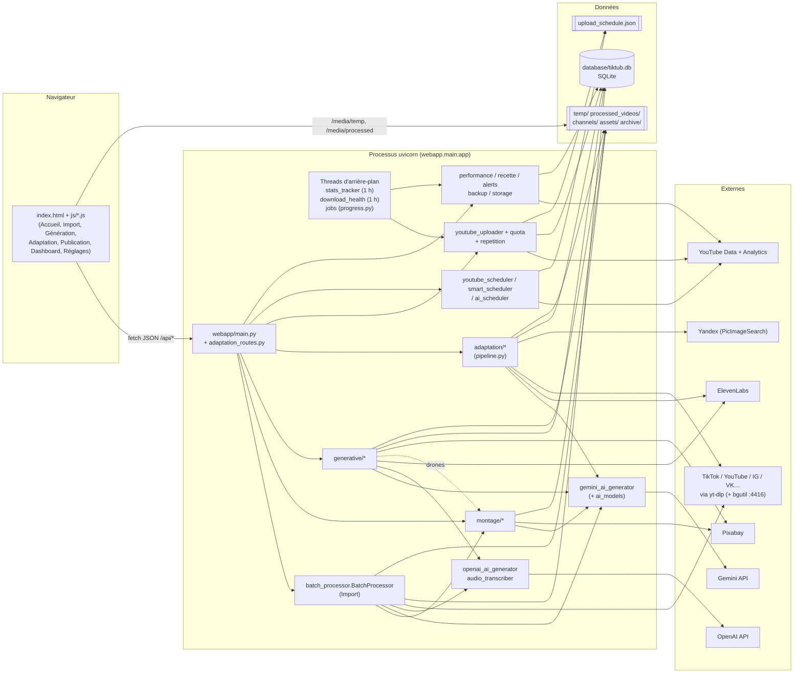
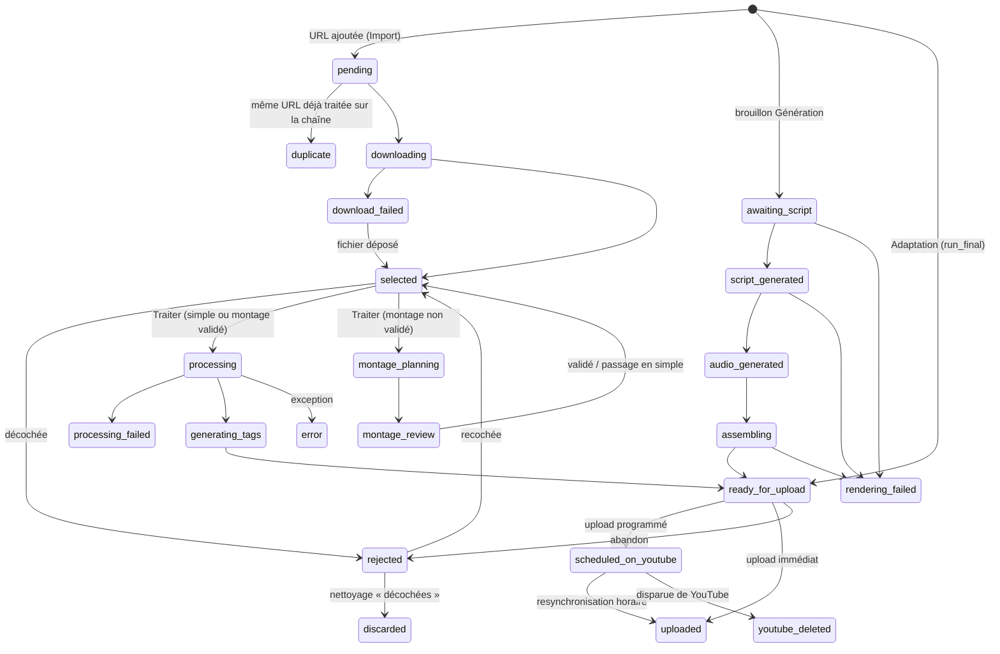
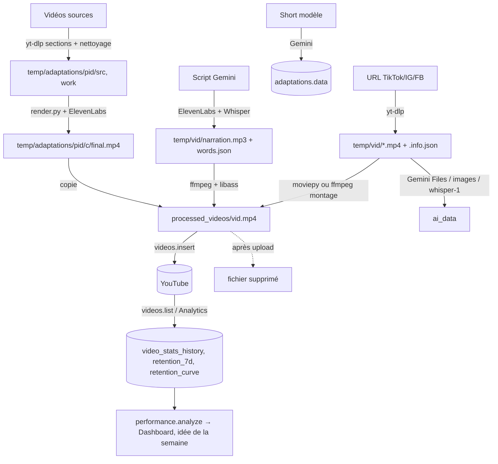

# Audit technique de TikTub

Audit en lecture seule du dépôt `TikTub` (branche `feature/scripts-varies`, dernier commit `2a39b22`), réalisé le 25/10/2026. Aucun fichier de code n'a été modifié ; ce document est le seul fichier créé.

**Conventions**
- Les chemins sont relatifs à la racine du projet ; `fichier.py:fonction()` désigne une fonction.
- **(hypothèse)** signale ce qui est déduit sans avoir été vérifié en exécutant le code.
- Les valeurs secrètes (`.env`, `config.yaml`, `channels/*/credentials.json`, `token.json`, `youtube_cookies.txt`) n'ont pas été lues ou ont été masquées ; seuls les noms de clés sont cités.

**Méthode suivie**
1. Inventaire : `git ls-files` (155 fichiers suivis) plus les dossiers non suivis (`channels/`, `database/`, `temp/`, `archive/`, `assets/broll`, `assets/voices`, `sfx_perso/`, `backgrounds/`, `.claude/`), en excluant `.venv`, `.git`, `__pycache__`, `.pytest_cache`.
2. Lecture intégrale des fichiers de code Python, des routes, du front-end JS/HTML et de la documentation (le détail de ce qui a été lu, survolé ou ignoré est en annexe A).
3. Graphe d'imports calculé par analyse AST des modules applicatifs.
4. Lecture des données en mode lecture seule (SQLite ouvert en `mode=ro`, `upload_schedule.json`) pour confirmer certains constats.
5. Exécution de la suite de tests dans des dossiers temporaires (`PYTHONDONTWRITEBYTECODE=1`, sans cache pytest) : rien n'a été écrit dans le projet.

---

## 1. Vue d'ensemble

### 1.1 À quoi sert le projet

TikTub est une **application web locale, mono-utilisateur**, qui alimente plusieurs chaînes **YouTube Shorts** (8 sont configurées dans `channels/channel_config.json` : `meme_culture`, `animeshorts`, `prince_moulay_hassan`, `lungte888`, `zit_bliss`, `lungtemotivates`, `cestpourca`, `lihadha_alsabab`).

Elle produit des vidéos de quatre façons, puis les publie :

| Source | Ce qu'elle fait | Code principal |
|---|---|---|
| **Import** | Télécharge des vidéos TikTok / Instagram / Facebook, les cadre en 9:16 sur un fond, génère titre, description et tags par IA | `batch_processor.py`, `video_processor.py`, `ai_tags_generator.py` |
| **Montage auto** (variante de l'Import) | Remonte un clip importé au style « hopecore » : écran noir, plans de drone, sous-titres en cascade, musique | `montage/` |
| **Génération** | Écrit des scripts par IA, les fait lire par ElevenLabs, les monte avec un fond, de la musique et des sous-titres animés | `generative/` |
| **Adaptation** | Refait un Short viral « explicatif » dans la langue de chaque chaîne : analyse du modèle, recherche des vidéos d'origine, script, voix, montage, contrôles | `adaptation/` |

Ensuite : planning de publication, envoi sur YouTube, suivi du quota, statistiques et rétention, analyse « Ce qui marche », alertes, sauvegardes, nettoyage du disque.

**Pour qui** : une seule personne qui gère ses propres chaînes, depuis un PC Windows sous WSL (chemin `/mnt/c/...`). Il n'y a ni comptes, ni authentification, ni déploiement serveur.

**Problème résolu** : produire et publier beaucoup de Shorts sur plusieurs chaînes et dans plusieurs langues, avec peu de travail manuel, tout en évitant le contenu répétitif que YouTube cesse de montrer. Un cas réel est documenté : le fil Shorts de `lungtemotivates` a été coupé fin septembre 2026 (`repetition.py`, `alerts.py`).

### 1.2 Stack technique

**Langages** : Python 3.12.3 (back-end), JavaScript sans framework ni bundler (front-end), HTML/CSS.

**Versions installées dans `.venv`** (les contraintes de `requirements.txt` sont entre parenthèses) :

| Domaine | Bibliothèque | Version |
|---|---|---|
| Serveur web | FastAPI | 0.141.1 (>=0.110) |
| | Starlette | 1.6.0 |
| | Uvicorn | 0.52.4 (>=0.29) |
| | Pydantic | 2.13.4 (>=2) |
| | python-multipart | 0.0.32 |
| Téléchargement | yt-dlp | 2026.8.30 dev (nightly) (>=2023.12.30) |
| | yt-dlp-ejs | 0.8.0 (épinglé) |
| | bgutil-ytdlp-pot-provider | 2.0.2 (épinglé) |
| | curl_cffi | 0.15.0 (épinglé) |
| Vidéo et image | moviepy | 1.0.3 (<2.0) |
| | imageio-ffmpeg | 0.6.0 (**non déclaré**, vient de moviepy) |
| | opencv-python | 5.0.0.93 |
| | numpy | 2.5.2 |
| | Pillow | 11.3.0 |
| | proglog | 0.1.12 (**non déclaré**, importé directement par `progress.py`) |
| IA et voix | faster-whisper | 1.2.1 (modèles `small` et `medium`, sur CPU) |
| | elevenlabs (SDK) | 2.66.0 (utilisé par `generative/` seulement) |
| | openai (SDK) | 3.3.1 (**déclaré mais jamais importé** : le code appelle OpenAI en REST via `requests`) |
| | PicImageSearch | 3.12.11 (épinglé, recherche d'image Yandex) |
| Google | google-api-python-client | 2.199.0 |
| | google-auth-oauthlib | 1.4.0 |
| Divers | requests | 2.34.2 |
| | PyYAML | 6.0.3 |
| | python-dateutil | 2.9.0 |
| | pytz | 2026.3 |
| | python-dotenv | 1.2.3 |
| Tests | pytest | 9.1.1 (`requirements-dev.txt`) |
| | httpx | 0.28.1 (**non déclaré** ; requis par `fastapi.testclient`, arrive via le SDK openai) |

**Base de données** : SQLite (`database/tiktub.db`, 4,3 Mo, accès avec le module standard `sqlite3`, sans ORM).

**Outils système** (vérifiés sur la machine) :
- `ffmpeg` 6.1.1 (Ubuntu), avec les filtres `subtitles`/`ass` (libass), `vidstabdetect`/`vidstabtransform`, `minterpolate`, `delogo`, `loudnorm`, `ebur128`, `sidechaincompress` et `xfade` ;
- `ffprobe` ;
- Node.js v24.21.0, pour le serveur bgutil installé dans `~/bgutil-ytdlp-pot-provider/server` et pour le runtime JS de yt-dlp ;
- polices système Linux : DejaVu, FreeSans, Liberation Serif, Noto Color Emoji, et une police CJK optionnelle.

**Services externes** :

| Service | Usage | Clé (`.env`) |
|---|---|---|
| Google Gemini (REST `generativelanguage.googleapis.com/v1beta`, modèles `gemini-flash-latest` et `gemini-pro-latest`, Files API) | Toute l'IA : analyse, scripts, recherches, vérifications, effets | `GEMINI_API_KEY` |
| OpenAI (REST `chat/completions` avec `gpt-4o-mini`, `audio/transcriptions` avec `whisper-1`) | Repli pour titres/tags et scripts, transcription en mode `audio` | `OPENAI_API_KEY` |
| ElevenLabs (SDK `eleven_v3` ; REST `with-timestamps` avec `eleven_multilingual_v2` ; `/v1/voices`, `/v1/shared-voices`) | Voix de la Génération et de l'Adaptation, bibliothèque de voix | `ELEVENLABS_API_KEY` |
| Pixabay Videos API | Bibliothèque de plans de drone | `PIXABAY_API_KEY` |
| YouTube Data API v3, YouTube Analytics API v2 (OAuth par chaîne) | Upload, miniatures, statuts, statistiques, rétention, sources de trafic | `channels/<c>/credentials.json` + `token.json` |
| YouTube oEmbed, `i.ytimg.com` | Titres et miniatures publiques | — |
| Yandex (par PicImageSearch, scraping) | Recherche par image | — |
| TikTok / Instagram / Facebook / YouTube / VK / Rutube… (par yt-dlp) | Téléchargements | `youtube_cookies.txt` optionnel |
| SerpApi | **Clé présente dans `.env` mais jamais utilisée par le code** (décision de ne pas l'intégrer, `ADAPTATION_BILAN.md`) | `SERPAPI_API_KEY` |

---

## 2. Architecture

### 2.1 Dossiers et rôle

| Dossier / fichier | Suivi par git | Rôle |
|---|---|---|
| `/` (racine, ~30 modules `.py`) | oui | Socle : base (`db.py`, `url_manager.py`), chaînes (`channel_manager.py`), Import (`batch_processor.py`, `video_processor.py`), IA historique (`gemini_ai_generator.py`, `openai_ai_generator.py`, `ai_tags_generator.py`, `audio_transcriber.py`), planning (`youtube_scheduler.py`, `smart_scheduler.py`, `ai_scheduler.py`, `youtube_analytics.py`), publication (`youtube_uploader.py`, `quota.py`, `repetition.py`), suivi (`stats_tracker.py`, `performance.py`, `alerts.py`), maintenance (`backup.py`, `storage.py`, `download_health.py`), transverses (`ai_models.py`, `recette.py`, `progress.py`), scripts ponctuels (`setup_channels.py`, `setup_openai.py`, `channel_profiles_seed.py`) |
| `webapp/` | oui | Serveur FastAPI (`main.py`, `adaptation_routes.py`) et interface en une seule page (`static/index.html`, `static/app.css`, `static/js/*.js`) |
| `montage/` | oui | Montage auto : transcription, plan Gemini, réglages, bibliothèque de drones, rendu ffmpeg ; polices Montserrat SemiBold et Instrument Serif |
| `generative/` | oui | Génération : plan de script, script, voix, styles de sous-titres, compositeur ffmpeg (repli moviepy), décor drones, orchestration |
| `adaptation/` | oui | Adaptation : 17 modules et polices Montserrat Black/ExtraBold et Tajawal Black/ExtraBold |
| `assets/sfx/` | oui | 15 bruitages CC0 et `LICENCES.md` |
| `assets/broll/` | non | Bibliothèque de plans Pixabay (`index.json`, `.mp4`, `.jpg`) ; ~519 Mo pour tout `assets/` |
| `assets/voices/` | non | Extraits officiels des voix ElevenLabs |
| `tests/` | oui | 33 fichiers pytest, 412 fonctions de test |
| `channels/<chaîne>/` | non | `profile.json` (réglages IA, Montage, Adaptation, Génération), `credentials.json`, `token.json`, `background.*`, `assets/backgrounds`, `assets/music`, `urls_input/` |
| `database/` | non | `tiktub.db`, `backups/` (zip quotidiens, 14 gardés), `download_health.json`, `analytics_cache.json`, `.last_cleanup`, `ai_models.json` (optionnel), `yt_dlp_backup/` (temporaire) |
| `temp/` | non | Travail par vidéo (`temp/<video_id>/`), projets Adaptation (`temp/adaptations/<pid>/`), `temp/usage/gemini.jsonl`, `temp/music_info/`, `temp/style_previews/` (161 Mo) |
| `processed_videos/` | non | Vidéos finales en attente d'upload (vide au moment de l'audit) |
| `archive/` | non | Copies par contenu des musiques et fonds utilisés (`recette.archive()`), 86 Mo |
| `sfx_perso/` | non | Bruitages ajoutés par l'utilisateur et `reglages.json` |
| `backgrounds/` | non | 4 images de fond génériques (mode `random`, plus utilisé par défaut) |
| `urls_input/` | partiellement | Exemples de fichiers d'URL (format historique) |
| Docs | oui | `README.md`, `NOUVEAUTES.md`, `MONTAGE_AUTO.md`, `ADAPTATION.md`, `ADAPTATION_BILAN.md`, `SECURITY.md`, `generative/README.md` |
| Docs non suivies | non | `deep-research-report (1).md` (tarifs des API d'IA), `deep-research-report (2).md` (étude d'outils pour le pipeline) |
| Médias en vrac à la racine | non | `136322-764387827_medium.mp4`, `Caleb Arredondo - Feeling Blue.mp3` |

### 2.2 Schéma des composants



Points d'architecture importants :
- **Un seul processus** : toutes les tâches longues (téléchargements, rendus, IA) tournent dans des `threading.Thread` démons du serveur uvicorn. Il n'y a ni file de tâches ni worker séparé : un redémarrage (`--reload` après une modification de code) les tue, et `recover_interrupted()` remet ensuite les statuts dans un état relançable.
- **Le répertoire courant est le dossier de données** : `webapp/main.py` fait `os.chdir(DATA_ROOT)` (variable `TIKTUB_DATA_DIR` ou racine du projet), et tous les modules utilisent des chemins relatifs (`database/…`, `temp/…`, `channels/…`).
- **Deux formes de persistance** coexistent : SQLite (vidéos, projets, statistiques, alertes, quota, voix, usage des drones, journal) et des fichiers JSON (planning `upload_schedule.json`, profils de chaînes, index des drones, réglages des bruitages, santé des téléchargements, cache analytics).
- **Gemini est le cerveau** : tous les appels passent par `GeminiAIGenerator._generate_content()`, qui choisit le modèle de l'étape appelante (`ai_models.STEPS`, résolu en remontant la pile d'appels) et note le coût dans `temp/usage/gemini.jsonl`.
- **Couplages croisés** : `generative/drone_montage.py` réutilise `montage/broll.py` et `adaptation/render.beats_of()` ; `download_health.py` réutilise `adaptation/sources.download()` ; `video_processor.py` importe `generative/caption_styles.py` ; `recette.py` importe `adaptation/pipeline.py`. Plusieurs imports sont circulaires mais faits à l'intérieur des fonctions (`alerts` ↔ `quota`, `alerts` ↔ `stats_tracker`, `recette` ↔ `adaptation.pipeline`, `adaptation.render` ↔ `annotate` ↔ `effects`).

### 2.3 Démarrage et ordre d'initialisation

Commande documentée : `uvicorn webapp.main:app --reload --port 8000` depuis la racine, avec le venv activé.

1. **Import de `webapp/main.py`**
   - ajout de la racine du projet à `sys.path` ;
   - `os.chdir(DATA_ROOT)` ;
   - import de `ChannelManager` et création du singleton `channel_manager` : crée `channels/` si besoin, et migre un ancien `credentials.json` de la racine vers `channels/default/` ;
   - création de `temp/` et `processed_videos/`, montage des statiques `/media/temp` et `/media/processed` ;
   - définition du middleware `log_actions_middleware` ;
   - import de `webapp.adaptation_routes` (routeur inclus au milieu des routes, ligne ~1381) ;
   - montage de `/static`.
2. **`lifespan()`** (au démarrage, chaque étape sans pouvoir bloquer le lancement) :
   1. `_recover_interrupted_jobs()` : appelle `get_batch_processor()`, ce qui **construit `BatchProcessor`**. Ce constructeur lit `config.yaml` (erreur 503 s'il manque), crée `URLManager` (`db.init_db()` exécute le `SCHEMA`, avec migration de l'ancien `videos_status.json`), `AITagsGenerator` (**qui envoie un appel de test à Gemini et un à OpenAI quand leurs clés sont présentes**), `YouTubeScheduler`, `ChannelManager`, `SmartScheduler` (avec chargement de `database/analytics_cache.json`) et `AIScheduler`. Puis remise des statuts interrompus (`INTERRUPTED_STATUSES`) et `adaptation.pipeline.recover_interrupted()` ;
   2. `_start_pot_server()` : lance `node ~/bgutil-ytdlp-pot-provider/server/build/main.js` (port 4416) s'il est installé et pas déjà actif ; le processus est détaché et jamais arrêté ;
   3. `_daily_backup_on_startup()` : thread qui exécute `backup.backup_if_due()` ;
   4. `_start_stats_tracker()` : thread horaire `stats_tracker.start_background_tracker()` ;
   5. `_download_health_loop()` : thread qui attend 90 s, puis vérifie toutes les heures si le contrôle quotidien des téléchargements est dû.
3. **Navigateur** : `GET /` renvoie `index.html` avec le numéro de build injecté (mtime le plus récent des fichiers statiques) ; les scripts se chargent dans l'ordre `core` → `accueil` → `import` → `reglages` → `adaptation` → `publication` → `dashboard` → `generation` → `performance` → `fichiers` → `boot`.
4. **`boot.js:boot()`** : `GET /api/channels`, masque l'onglet Génération si aucune chaîne n'a `generation_mode`, prépare la grille des URL, lit les vidéos téléchargées, ouvre l'Accueil et interroge `/api/alerts` toutes les 60 s.
5. **Lazy loading** : les modèles Whisper (`small` pour la Génération, `medium` pour le Montage) et `GenerativePipeline` ne sont chargés qu'au premier usage.

---

## 3. Fichier par fichier

« Importe » ne cite que les modules du projet ; « Utilisé par » vient du graphe d'imports. « — » veut dire qu'aucun module applicatif ne l'importe : c'est un script autonome ou du code mort.

### 3.1 Racine : socle et données

| Fichier (lignes) | Rôle | Fonctions / classes principales | Importe | Utilisé par |
|---|---|---|---|---|
| `db.py` (536) | Accès SQLite, schéma créé avec `CREATE TABLE IF NOT EXISTS` (sans migration versionnée) | `SCHEMA`, `get_connection`, `init_db`, `load_all`, `replace_all`, `upsert_video`, `get_video`, `delete_video`, `query_videos`, `find_duplicate_by_url`, `insert_batch`, `insert_stats_snapshot`, `get_stats_history`, `get_captured_checkpoints`, `log_action`, `list_action_log`, `add_quota_usage`, `set_quota_exhausted`, `get_quota_usage`, `record_broll_usage`, `recent_broll_clips`, `broll_last_used`, `broll_usage_counts`, `upsert_voice`, `list_voices`, `get_voice`, `delete_voice`, `save_adaptation`, `get_adaptation`, `list_adaptations`, `delete_adaptation` | — | 15 modules |
| `url_manager.py` (251) | Façade historique au-dessus de `db.py` pour les vidéos et lots ; migration unique de `videos_status.json` | `URLManager` : `parse_url_file` (format `url \| titre \| fond \| priorité \| description`), `add_batch` (id `nom_date_uuid6`), `update_video_status` (lecture puis écriture d'une ligne), `find_duplicate`, `record_publish_decision`, `add_stats_snapshot`, `list_videos`, `delete_video`, `get_status_summary` | `db` | `batch_processor`, `generative.pipeline`, `storage`, `youtube_uploader` |
| `channel_manager.py` (325) | Chaînes : `channels/channel_config.json`, `profile.json`, chemins OAuth, dossiers d'assets | `ChannelManager` : `list_channels`, `get_channel_profile` (crée un profil par défaut s'il manque), `save_channel_profile`, `get_channel_paths` (« default » retombe sur la 1re chaîne), `get_assets_dirs`, `get_background_path`, `add_channel`, `delete_channel`, `select_channel_interactive` (CLI) | — | 11 modules |
| `storage.py` (182) | Place disque et nettoyage par catégorie (publié, orphelin, décoché, en cours) | `scan`, `cleanup`, `cleanup_if_due` (repère `database/.last_cleanup`), `_adaptation_items` | `db`, `url_manager` | `stats_tracker`, `webapp.main` |
| `backup.py` (155) | Zip quotidien : base (API de sauvegarde en ligne de SQLite), `upload_schedule.json`, `channel_config.json`, `profile.json`, fonds et `sfx_perso` ; 14 gardés ; restauration réversible | `create_backup`, `list_backups`, `prune`, `backup_if_due`, `restore_backup`, `_safe_name`, `_sqlite_copy` | `db` | `stats_tracker`, `webapp.main` |
| `progress.py` (108) | Jobs de progression en mémoire et logger proglog pour moviepy | `EncodeProgress`, `start`, `update`, `finish`, `get` (ETA), `update_item`, `is_running` | — | `generative.video_composer`, `video_processor`, `webapp.*` |
| `recette.py` (268) | « Recette » commune d'une vidéo (type, accroche, structure, musique, voix, style, détails) ; archivage des assets par empreinte MD5 ; reconstruction pour les anciennes vidéos | `make`, `from_adaptation`, `from_generation`, `from_montage`, `from_import`, `archive`, `kind_of`, `rebuild`, `backfill`, `used_by`, `first_sentence` | `adaptation.pipeline`, `channel_manager`, `montage.recipes` | `adaptation.pipeline`, `batch_processor`, `generative.pipeline` |
| `ai_models.py` (119) | Table « étape → modèle Gemini », prix et coût du mois | `STEPS` (23 étapes), `PRICES`, `model_for` (surcharge par `database/ai_models.json`), `price`, `cost`, `month_report` | `gemini_ai_generator` (lazy) | `gemini_ai_generator`, `webapp.main` |

### 3.2 Racine : Import, IA historique, planning

| Fichier (lignes) | Rôle | Fonctions / classes principales | Importe | Utilisé par |
|---|---|---|---|---|
| `batch_processor.py` (739) | Orchestrateur de l'Import et du planning | `explain_download_error` ; `BatchProcessor` : `process_url_file`, `process_channel_url_file`, `download_batch`, `download_tiktok_video` (yt-dlp), `process_selected_videos`, `render_montage`, `process_tiktok_video`, `generate_ai_content`, `regenerate_ai_content`, `get_frame_suggestion`, `set_video_frame_mode`, `create_upload_schedule`, `ensure_schedule_includes_all_ready`, `_shift_off_taken_slots`, `_parse_slot`, `_record_schedule_decisions` | `url_manager`, `ai_tags_generator`, `youtube_scheduler`, `smart_scheduler`, `ai_scheduler`, `channel_manager`, `montage.*`, `recette`, `db`, `video_processor` | `webapp.main` |
| `video_processor.py` (495) | Rendu moviepy de l'Import (cadrage 9:16, fond, coins arrondis) et aperçus d'une image | `crop_black_borders` (8 images échantillonnées), `compute_frame_scale`, `render_frame_preview` (+ superposition d'un style de sous-titres), `suggest_frame_mode`, `get_video_dimensions`, `is_decodable_video`, `processed_output_paths`, `process_video_with_background_options` (**coupe à 60 s**), `rounded_corner_mask` | `generative.caption_styles`, `progress` | `batch_processor`, `generative.*`, `webapp.main` |
| `ai_tags_generator.py` (510) | Cascade Gemini → OpenAI → modèles locaux pour titre, description et tags d'une vidéo importée ; charge `.env` à l'import | `AITagsGenerator` : `generate_ai_content` (modes `vision`, `audio`, `vision+audio`, `native_video`), `_normalize_ai_result`, `generate_basic_ai_content`, plus des méthodes héritées (`generate_tags_local`, `generate_tags_openai` cassée, …) | `gemini_ai_generator`, `openai_ai_generator`, `audio_transcriber` | `batch_processor` |
| `gemini_ai_generator.py` (693) | Client REST Gemini unique de toute l'app | `GeminiAIGenerator._generate_content` (JSON forcé, `thinkingBudget`, modèle par étape, journal d'usage), `call_gemini_api`, `_upload_video_file`/`_wait_for_file_active`/`_delete_file` (Files API), `analyze_video_content`, `analyze_video_native`, `generate_titles/description/tags`, `generate_ai_data`, `log_usage`, `_asking_step` (introspection de la pile), `plain_error`, `CREDITS_OUT` | `ai_models` | 10 modules |
| `openai_ai_generator.py` (519) | Client REST OpenAI (`gpt-4o-mini`), copie presque conforme du générateur Gemini | `OpenAIGenerator` : `call_openai_api`, `analyze_video_content`, `generate_ai_data` (avec `precomputed_analysis`), replis | — | `ai_tags_generator`, `generative.script_generator`, `setup_openai` |
| `audio_transcriber.py` (81) | Extrait l'audio avec moviepy et le transcrit avec l'API OpenAI `whisper-1` | `AudioTranscriber.extract_audio`, `transcribe` | — | `ai_tags_generator` |
| `youtube_scheduler.py` (261) | Créneaux fixes (jours et heures préférés, espacement, plafond hebdomadaire) ; lecture/écriture de `upload_schedule.json` | `YouTubeScheduler` : `get_optimal_publish_times`, `find_next_optimal_slot`, `create_upload_schedule` (séquence par chaîne), `validate_schedule`, `save_schedule` (mémorise `schedule_method`), `load_schedule` | — | `batch_processor` |
| `smart_scheduler.py` (259) | Méthode « Analytics » : heures génériques et jours forts réels | `SmartScheduler` : `get_channel_peak_times` (cache 24 h, fichier `database/analytics_cache.json`), `get_channel_best_weekdays`, `create_analytics_based_schedule` (**bugs, §8.3**) | `youtube_analytics` | `batch_processor` |
| `ai_scheduler.py` (167) | Méthode « IA par vidéo » : demande des créneaux à Gemini puis à OpenAI, puis impose espacement et plafond journalier | `AIScheduler._ask_ai_for_slots`, `create_ai_suggested_schedule` | — | `batch_processor` |
| `youtube_analytics.py` (173) | Wrapper YouTube Analytics pour le planning | `YouTubeAnalytics` : `authenticate_analytics`, `get_channel_id`, `get_daily_engagement_data`, `get_best_weekdays`, `get_peak_hours` (renvoie toujours `[8, 12, 18, 20]`) | `channel_manager` | `smart_scheduler` |

### 3.3 Racine : publication, suivi, maintenance

| Fichier (lignes) | Rôle | Fonctions / classes principales | Importe | Utilisé par |
|---|---|---|---|---|
| `youtube_uploader.py` (1466) | OAuth, upload, statistiques, analytics, visibilité ; contient aussi l'ancienne CLI | OAuth web : `start_oauth_flow`, `complete_oauth_flow`, `get_connection_health`, `get_connected_channel_title`, `has_edit_scope`, `has_analytics_scope`. Données : `get_video_stats`, `get_video_analytics`, `get_first_week_retention`, `get_retention_curve`, `get_daily_feed_views`, `get_channel_analytics`, `update_video_visibility`. Upload : `authenticate_youtube`, `upload_video`, `upload_channel_schedule`, `upload_all_channels_schedule`, `effective_scheduled_time`, `update_video_status` (supprime les fichiers locaux), `QuotaExceededError`, `http_error_reason`. CLI morte : `main`, `upload_scheduled_videos`, `reupload_to_different_channel`, `select_channel` | `channel_manager`, `db`, `quota`, `repetition`, `url_manager` | `alerts`, `stats_tracker`, `webapp.main` |
| `quota.py` (124) | Quota YouTube par projet Google Cloud (empreinte SHA-1 du `client_id`) et par jour du Pacifique | `quota_day`, `next_reset`, `load_settings`, `project_key`, `project_key_for_channel`, `record_upload`, `mark_exhausted`, `is_exhausted`, `status_for_channel` | `db`, `channel_manager`, `alerts` | `alerts`, `webapp.main`, `youtube_uploader` |
| `repetition.py` (124) | Garde anti-répétition sans IA (difflib) : blocage à ≥ 85 % de script ou ≥ 90 % de titre, avertissements en dessous | `fingerprint`, `check`, `too_close`, `blocking_message`, `_norm` | — | `generative.pipeline`, `youtube_uploader` |
| `stats_tracker.py` (263) | Boucle horaire en arrière-plan | `start_background_tracker`, `sync_youtube_statuses`, `run_snapshot_cycle` (relevés à 24 h, 3 j, 7 j, 30 j), `sync_retention` (à J+9, 60 vidéos par cycle), `published_moment` | `youtube_uploader`, `alerts`, `backup`, `storage` (lazy) | `alerts`, `performance`, `webapp.main` |
| `performance.py` (412) | « Ce qui marche », idée de la semaine, courbe par plan, versions A/B | `analyze` (score = (vues 7 j + 10) / (médiane + 10)), `video_row`, `recipe_attrs`, `DIMENSIONS` (18), `recipe`, `suggest`, `shots_of`, `curve_by_shot`, `versions`, `_winner` | `stats_tracker`, `db` | `webapp.*` |
| `alerts.py` (209) | Alertes dédupliquées par clé (connexion, quota, publication, vidéo supprimée, fil Shorts arrêté) | `raise_alert`, `resolve`, `dismiss`, `active`, `connection_state`, `check_connections`, `feed_state`, `check_shorts_feed` (toutes les 6 h), `quota_exhausted`, `publish_result`, `video_deleted` | `db`, `quota`, `channel_manager`, `youtube_uploader`, `stats_tracker` | `quota`, `stats_tracker`, `webapp.main` |
| `download_health.py` (244) | Contrôle quotidien de 3 téléchargements de test (dans un sous-processus) et mise à jour de yt-dlp avec retour arrière | `run_tests`, `check_in_subprocess`, `record`, `check_and_record`, `is_due`, `update`, `_copy_installed`, `_put_back`, `_pip`, `versions` ; exécutable avec `--json` | `adaptation.sources` | `webapp.main` |

### 3.4 Racine : scripts ponctuels et fichiers morts

| Fichier | Rôle | Remarque |
|---|---|---|
| `setup_channels.py` (310) | Assistant CLI pour lister, ajouter ou supprimer des chaînes | Textes obsolètes (« Run youtube_uploader.py / batch_processor.py ») |
| `setup_openai.py` (181) | Assistant CLI pour la clé OpenAI, qu'il écrit dans `.env` | — |
| `channel_profiles_seed.py` (116) | Crée ou écrase les profils de 6 chaînes | **Écrase tout `profile.json`** : les réglages `montage`, `adaptation`, `generation_mode` et `tts_*` sont perdus si on le relance |
| `enhanced_ai_generator.py` (0 octet) | Vide | Code mort |
| `urls.txt.example` (0 octet) | Vide | Mentionné dans `SECURITY.md` |
| `sample_ai_result.json` | Exemple de sortie IA (2025) | Non utilisé |
| `urls_input/example_batch.txt(.example)` | Exemples au format historique | `example_batch.txt` est suivi par git alors que le `.gitignore` l'exclut (ajouté avant la règle) |
| `config.yaml.example`, `.env.example`, `requirements*.txt`, `pytest.ini`, `.gitignore` | Configuration | Voir §7 |

### 3.5 `montage/` (Montage auto)

| Fichier | Rôle | Fonctions principales | Importe | Utilisé par |
|---|---|---|---|---|
| `__init__.py` | Docstring de présentation | — | — | — |
| `recipes.py` (95) | Recette « hopecore » et réglages en 3 couches (recette < `profile["montage"]` < `video["montage_overrides"]`) | `RECIPES`, `DEFAULT_SETTINGS`, `clean_settings`, `channel_settings`, `resolve_settings`, `edit_mode`, `recipe` | — | `batch_processor`, `montage.*`, `recette`, `webapp.main` |
| `transcribe.py` (29) | faster-whisper `medium` (CPU, int8), singleton global | `transcribe` | — | `montage.*` |
| `planner.py` (129) | Gemini regarde le clip (Files API) et répond en indices de mots | `PLAN_PROMPT`, `KEYWORDS_PROMPT`, `plan_video`, `pick_keywords`, `unsuitable_reason`, `video_duration`, `PlanError` | `gemini_ai_generator`, `montage.transcribe` | `montage.pipeline`, `montage.render` |
| `broll.py` (189) | Bibliothèque partagée de plans de drone Pixabay et mémoire de réutilisation | `fetch` (≥ 1920 px, `safesearch`), `list_clips`, `get_clip`, `delete`, `reserved`, `pick`, `record_usage`, `usage_counts`, `make_thumbnail`, `_migrate_usage_json` | `db` | `generative.drone_montage`, `montage.pipeline`, `webapp.main` |
| `render.py` (473) | Contrôle du plan et rendu en une seule passe ffmpeg | `Edit`, `resolve_plan`, `drone_slots`, `box_geometry`, `frame_overlay` (accroche + coins), `captions_ass` (cascade en zigzag), `rms_db`, `music_keypoints`, `keypoints_expr`, `render`, `_run_ffmpeg` | `montage.*` | `montage.pipeline` |
| `pipeline.py` (156) | Intégration dans l'Import | `prepare_review`, `render_preview`, `render_final`, `swap_broll`, `timeline`, `music_path`, `work_dir`, `_broll_files` | `montage.*` | `batch_processor`, `webapp.main` |
| `fonts/` | Montserrat SemiBold, Instrument Serif Italic et leurs licences OFL | — | — | `render.py` |

### 3.6 `generative/` (Génération)

| Fichier | Rôle | Fonctions principales | Importe | Utilisé par |
|---|---|---|---|---|
| `__init__.py` | Vide | — | — | — |
| `README.md` | Explique la synchronisation voix ↔ sous-titres (Whisper) | **Obsolète** sur l'API et le rendu (§8.5) | — | — |
| `script_plan.py` (166) | Plan du script choisi par rotation (format, sujet, accroche, fin) | `FORMATS` (A, D, B, M, C, E, L, P), `TOPICS`, `HOOKS`, `ENDINGS`, `FAKE_TESTIMONY`, `choose`, `describe`, `examples`, `opening`, `overused_openings` | — | `generative.pipeline`, `generative.script_generator` |
| `script_generator.py` (150) | Prompt et appel Gemini, puis OpenAI en repli ; charge `.env` | `_build_prompt`, `generate_script`, `_is_usable` | `gemini_ai_generator`, `openai_ai_generator`, `generative.script_plan` | `generative.pipeline` |
| `voice_generator.py` (127) | Voix ElevenLabs (SDK, `eleven_v3`) et horodatage mesuré par faster-whisper `small` (langue `fr` en dur) | `synthesize`, `_align_to_whisper`, `_normalize` | — | `generative.*` |
| `caption_styles.py` (517) | 6 styles de sous-titres en moviepy et leurs aperçus | `STYLES`, `PREVIEWS`, `CUSTOMIZABLE_COLOR_STYLES`, `group_into_lines/blocks/chunks`, `drawn_words_width`, `fit_scale`, `*_build_clips`, `*_preview_frame` | `generative.voice_generator` | `generative.*`, `video_processor` |
| `ffmpeg_composer.py` (479) | Même rendu en une passe ffmpeg + libass (3 à 5 fois plus rapide) | `ASS_STYLES`, `BUILDERS`, `build_ass`, `FontSpec`, `_music_filters` (ducking par `sidechaincompress`), `render_video_ffmpeg`, `ffmpeg_exe` (binaire imageio-ffmpeg) | `generative.*`, `video_processor` | `generative.pipeline`, `generative.video_composer` |
| `video_composer.py` (138) | Aiguillage ffmpeg, avec repli moviepy en cas d'erreur ou si `TIKTUB_RENDERER=moviepy` | `render_video`, `render_video_moviepy`, `_build_background_layers` | `generative.*`, `video_processor`, `progress` | `generative.pipeline` |
| `drone_montage.py` (174) | Décor « un plan de drone par phrase », coupes calées sur la musique | `shot_bounds`, `choose_clips` (réserve les plans dès le choix), `build`, `LOOKS`, `MOVES`, `THEMES` | `montage.broll`, `db`, `generative.caption_styles`, `adaptation.render` | `generative.pipeline`, `webapp.main` |
| `pipeline.py` (399) | Orchestration de la Génération en 3 phases | `GenerativePipeline` : `create_draft`, `_decor_preset`, `generate_script_for` (jusqu'à 3 essais), `_script_problems`, `run_batch_scripts`, `update_script`, `list_assets`, `voice_of`, `generate_audio_for`, `run_batch_audio`, `set_decor`, `assemble`, `advance_draft` | `channel_manager`, `db`, `url_manager`, `generative.*`, `recette`, `repetition` | `webapp.main` |

### 3.7 `adaptation/` (Adaptation)

| Fichier | Rôle | Fonctions principales | Utilisé par |
|---|---|---|---|
| `__init__.py` | Docstring de présentation (incomplète : ne cite pas finder, storyboard, effects, annotate, sfx, tone, frames, imagesearch) | — | — |
| `langs.py` (52) | Apparence par langue (fr, ar en RTL, en) | `LANGS`, `lang`, `font_path` | render, script, storyboard, pipeline, webapp |
| `settings.py` (112) | Bibliothèque de voix et réglages Adaptation de chaque chaîne | `add_voice`, `rename_voice`, `remove_voice`, `display_name`, `channel_language`, `channel_settings`, `clean_update`, `voices_for` | pipeline, webapp |
| `voices.py` (115) | ElevenLabs en REST : informations sur une voix, extrait, synthèse avec horodatage par caractère (`eleven_multilingual_v2`) | `fetch_info`, `download_preview`, `synthesize`, `align`, `VoiceError` | settings, pipeline |
| `reference.py` (70) | Analyse du Short modèle (lien YouTube direct à 4 i/s, sinon téléchargement et Files API) | `PROMPT`, `analyse`, `ReferenceError` (masque le nom intégré Python) | pipeline |
| `tone.py` (103) | Ton du sujet → plafonds d'effets et de sons, consigne pour la musique | `TONES`, `valid`, `of`, `guess`, `effect_limits`, `sound_rules`, `music_hint`, `choices` | effects, pipeline, settings, webapp |
| `storyboard.py` (363) | Mode « Script d'abord » : angles, storyboard multilingue, relecture, problèmes, adaptation d'un plan | `angles`, `write`, `critique`, `revise`, `normalise`, `illustration`, `unfilmable`, `problems`, `durations`, `script_for`, `clean_annotation`, `adapt_to` | pipeline, script, annotate |
| `script.py` (319) | Script par langue (mode « Sources d'abord »), relecture, contrôle phrase ↔ image | `write`, `critique`, `revise`, `normalise`, `problems`, `budgets`, `clip_listing`, `match`, `estimated_seconds`, `LANG_RULES` | pipeline, storyboard |
| `finder.py` (973) | Recherche des vidéos sources et vérification par Gemini | `scenes`, `credit_links`, `search_links`, `search_youtube`, `search_channel`, `sort_out`, `local_queries`, `plan_queries`, `action_queries`, `wanted_from_storyboard`, `suggest`, `verify_best`, `check`, `_watch`, `_send_file`, `auto_pick`, `follow_remontages`, `cited_in`, `sections`, `real_faults`, `warnings_of`, `model_of`, `same_video` | pipeline, frames |
| `imagesearch.py` (122) | Recherche d'image Yandex (asynchrone) | `search`, `timed_search`, `rank`, `canonical`, `platform` | finder, pipeline, sources |
| `frames.py` (163) | Images nettoyées des plans du Short (pour la recherche par image) | `reference_frames`, `clean`, `_fill` (inpainting OpenCV), `_public_frames` | finder, pipeline |
| `sources.py` (1047) | Téléchargement (yt-dlp, PO token, cookies, sections), fichiers déposés, découpe en plans, nettoyage (crop, delogo, inpainting), descriptions Gemini | `start_pot_server`, `ytdlp_opts`, `download`, `_fetch`, `_fetch_once`, `reachable`, `save_local`, `probe`, `detect_cuts`, `find_peak`, `describe`, `retime`, `find_boxes`, `leftover_text`, `erase_drawn_marks`, `clip_at`, `analyse_source`, `still`, `clip_still`, `clip_preview`, `orientation`, `rotated`, `black_bars`, `explain` | 10 modules |
| `effects.py` (353) | Ralenti, zoom, arrêt sur image, transition, chiffre ; carte temporelle commune à tous les calques | `clean`, `cap`, `pieces`, `out_at`, `src_at`, `hold_at`, `fit`, `zoom_of`, `decide`, `auto_zoom`, `on_screen` | annotate, pipeline, render, script |
| `annotate.py` (309) | Flèches et cercles qui suivent la cible (box_2d Gemini sur 4 images) | `window`, `after_last_cut`, `to_box`, `locate`, `track`, `frames`, `prepare`, `review` | pipeline, render |
| `sfx.py` (262) | Bruitages placés par règles (sans IA) et réglages | `RULES`, `library`, `catalog`, `set_active`, `add`, `remove`, `plan`, `sounds`, `peak_of` | render, webapp |
| `render.py` (1005) | Rendu : un ffmpeg par plan, puis assemblage et calques | `STYLES` (5 styles visuels), `build_timeline`, `beats_of`, `banner_png`, `credit_png`, `captions_ass`, `clip_chain`, `_played`, `look`, `shakiness`, `stabilised`, `music_gain`, `hush_at`, `number_frames`, `_picture_box`, `render`/`_render` (sémaphore pour les rendus finaux), `style_preview` | 7 modules dont `generative.drone_montage` |
| `checks.py` (90) | Contrôle mesuré : durées son/image, LUFS, position des phrases | `verify`, `sentence_offsets`, `loudness`, `_match` | pipeline |
| `pipeline.py` (2187) | Machine à états d'un projet et passage vers la Publication | `create`, `run_analysis`, `write_storyboard`, `edit_plan`, `approve_plan`, `start_images`, `run_images`, `SharedSearch`, `choose_pick`, `check_plan_link`, `file_for_plan`, `adapt_plan`, `start_fetch`, `run_fetch`, `run_scripts`, `edit_script`, `approve_script`, `run_voices`, `change_voice`, `validate_preview`, `start_render`, `run_final`, `publication_record`, `retry`, `recover_interrupted`, `RUNNERS`, `BUSY`, etc. | recette, webapp |
| `fonts/` | Montserrat Black/ExtraBold, Tajawal Black/ExtraBold et leurs licences OFL | — | langs |

### 3.8 `webapp/`

| Fichier | Rôle |
|---|---|
| `__init__.py` | Vide |
| `main.py` (2345) | Application FastAPI : cycle de vie, middleware de journal, singletons (`channel_manager`, `_batch_processor`, `_generative_pipeline`), 100 routes (Import, Montage, drones, bruitages, voix, Génération, planning, publication, Dashboard, fiche, sauvegardes, stockage, alertes, santé), statiques et page. Fonctions utilitaires : `serialize_video`, `serialize_montage`, `serialize_generated_video`, `video_media_url`, `_safe_asset_path`, `_start_batch_thread`, `_start_assembly`, `_pending_schedule`, `_retention_curve`, `frontend_build`, `recover_interrupted` |
| `adaptation_routes.py` (752) | Routeur de l'Adaptation (51 routes `/api/adaptations/*` et réglages Adaptation des chaînes) ; `_start_adaptation_step` lance l'étape dans un thread ; `_serialize_adaptation` |
| `static/index.html` (460) | Squelette de la page : 7 espaces, écrans numérotés `data-idx` 0 à 14, boîtes de dialogue |
| `static/app.css` (625) | Thème sombre, composants (cartes, pastilles, calendrier, adaptation…) |
| `static/js/core.js` | `api()` (délai de 20 s sur les GET, contrôle du build), navigation (`STEP_SPACES`, `goTo`, `openSpace`), `esc`, `log`/`toast`, `CHANNEL_COLORS` (6 chaînes en dur), `SCRIPT_FORMATS` (copie de `script_plan`) |
| `static/js/boot.js` | Alertes (avec notifications navigateur), `boot()` |
| `static/js/accueil.js` | `ICONS`/`icon()`, `loadHome` (compteurs, cartes de chaînes, erreurs), coût de l'IA, santé des téléchargements, idée de la semaine |
| `static/js/import.js` | Connexion OAuth (fenêtre popup), URL et suivi des téléchargements, Sélection, Cadrage (aperçu d'une image), revue du Montage auto |
| `static/js/reglages.js` | Réglages Montage, Drones, Effets sonores, Voix, réglages Adaptation par chaîne ; `adDropFile`, `adOriginalsHtml` (utilisés par l'Adaptation) |
| `static/js/adaptation.js` | Tout l'espace Adaptation (création, recherche, storyboard, images, sources, scripts, aperçus, rendu) |
| `static/js/publication.js` | Résultats IA, fonds, planning (liste et calendrier en glisser-déposer), récapitulatif et contrôle avant publication, « Publier tout » |
| `static/js/dashboard.js` | Vidéos publiées, vue d'ensemble de la chaîne sur 30 jours, statistiques détaillées, visibilité |
| `static/js/performance.js` | « Ce qui marche », versions FR/AR, fiche vidéo, « Refaire ce style » (Génération et Adaptation) |
| `static/js/generation.js` | Lots de Génération : scripts, voix, décor avec aperçu, création |
| `static/js/fichiers.js` | Dépôt d'un fichier pour un téléchargement échoué, sauvegardes, stockage |

### 3.9 `tests/`

| Fichier | Tests | Ce qui est couvert |
|---|---|---|
| `conftest.py` | — | Dossier temporaire par test, clés IA vidées, `FakeYouTube`, `quota_http_error`, client FastAPI |
| `test_adaptation.py` | 44 | Moteur Adaptation : timeline, sous-titres, bandeaux, découpe, problèmes de script, crédits, finder, imagesearch, frames, rendu d'aperçu réel |
| `test_adaptation_storyboard.py` | 64 | Mode « Script d'abord » de bout en bout : storyboard, choix automatique, téléchargement, juge, extraits, versions, groupes |
| `test_adaptation_effects.py` | 27 | Effets, éclairage, couleurs, stabilisation, beats, musique, marques dessinées (**un test défini deux fois, donc masqué**) |
| `test_adaptation_flow.py` | 22 | Projet complet de bout en bout (avec doublures), API, reprises, liens morts |
| `test_adaptation_judge.py` | 15 | Juge phrase ↔ image, crédits, journal de coût, budget de vérification |
| `test_adaptation_sfx.py` | 12 | Règles de bruitage, ajout et désactivation, API |
| `test_adaptation_annotate.py` | 9 | Flèches et cercles |
| `test_adaptation_tone.py` | 8 | Ton |
| `test_adaptation_dropped_file.py` | 7 | Fichiers déposés |
| `test_adaptation_download.py` | 5 | Ordre cookies / sans cookies, qualité, accessibilité |
| `test_adaptation_originals.py` | 5 | Remontages → originaux |
| `test_adaptation_remake.py` | 5 | « Refaire ce style » pour l'Adaptation |
| `test_montage.py` | 23 | Contrôle du plan, sous-titres, musique, réglages, sélection des drones, aperçu réel |
| `test_montage_flow.py` | 10 | Montage dans l'Import, API |
| `test_performance.py` | 21 | Classement, groupes, idée de la semaine, courbe, versions, fiche |
| `test_progress.py` | 16 | Progression, jobs en arrière-plan, reprise après redémarrage, dépôt de fichier |
| `test_upload.py` | 17 | Publication : bon fichier, titre courant, connexion, quota, dates |
| `test_webapp.py` | 14 | États de connexion, contrôle avant publication, calendrier, abandon, build |
| `test_ffmpeg_composer.py` | 11 | Fichiers ASS, rendus ffmpeg réels, repli moviepy |
| `test_download_health.py` | 8 | Santé des téléchargements et mise à jour (doublures) |
| `test_stats.py` | 7 | Resynchronisation des statuts, relevés, rétention |
| `test_quota.py` | 7 | Jour de quota, partage par projet |
| `test_drone_montage.py` | 6 | Décor drones |
| `test_alerts.py` / `test_backup.py` / `test_storage.py` / `test_repetition.py` / `test_schedule.py` | 6 chacun | Modules correspondants |
| `test_recette.py` / `test_script_plan.py` / `test_ai_models.py` | 5 chacun | Modules correspondants |
| `test_crop.py` | 4 | Détection des bandes noires |

---

## 4. Fonctionnalités et parcours

Notation : écran (fichier JS) → route → fonctions Python → résultat. Les statuts de vidéo sont détaillés au §5.1.

### 4.1 Réglages

**F1. Connecter une chaîne YouTube** (Réglages → Connexion)
- `import.js:startConnect()` → `POST /api/channels/{c}/connect/start` → `youtube_uploader.start_oauth_flow()` : crée un `Flow` depuis `channels/{c}/credentials.json`, redirection vers `http://localhost:{port}/api/oauth/callback`, `state` gardé dans `_pending_oauth_flows` (en mémoire).
- Popup Google → `GET /api/oauth/callback` → `complete_oauth_flow()` : `fetch_token` puis écriture de `token.json` (4 scopes : upload, readonly, force-ssl, yt-analytics.readonly).
- À la fermeture de la popup : `GET /api/channels/{c}/connection_status` → `get_connection_health()` (`channels.list(mine=True)`, état `connected` / `expired` / `not_connected` / `missing_credentials` / `error`) et `alerts.connection_state()`.
- `OAUTHLIB_INSECURE_TRANSPORT=1` est forcé au chargement de `youtube_uploader.py`.

**F2. Fond par défaut d'une chaîne** (Réglages → Fonds) : `publication.js:loadBackgrounds()` → `POST|DELETE /api/channels/{c}/background` → fichier `channels/{c}/background.{jpg,jpeg,png}`. Il est utilisé par `BatchProcessor.get_background_for_video()` (sinon fond noir) et par le compositeur de la Génération (`border_image_path`).

**F3. Style du Montage auto par chaîne** (Réglages → Montage) : `reglages.js:renderMontageSettingsCard()` → `PUT /api/channels/{c}/montage` → `recipes.clean_settings()` → `profile["montage"]`. On peut aussi envoyer un morceau (`POST /api/channels/{c}/assets/music`, extensions audio seulement ; un fichier du même nom est écrasé) et choisir le moment d'entrée de la musique avec le lecteur.

**F4. Bibliothèque de drones** (Réglages → Drones) : `POST /api/broll/fetch` → `broll.fetch(theme, count)` (API Pixabay, rendu ≥ 1920 px, téléchargement en `.part` puis renommage, miniature ffmpeg) ; `DELETE /api/broll/{id}` ; compteurs d'usage par chaîne (`db.broll_usage_counts`) ; alerte si moins de 30 plans.

**F5. Voix et langue par chaîne** (Réglages → Voix)
- Ajout de voix : `POST /api/voices` → `settings.add_voice()` → `voices.fetch_info()` (`/v1/voices/{id}`, sinon `/v1/shared-voices`) → extrait téléchargé dans `assets/voices/{id}.mp3` → table `voices`. Les voix peuvent être renommées ou retirées.
- Par chaîne : `PUT /api/channels/{c}/adaptation` → `profile["language_hint"]` (fr / ar / en, qui est aussi la langue des titres de l'IA) et `profile["adaptation"]` (`voice_id`, `music_file`, `music_start`, `style` parmi 5, `ton` fixe ou None).
- Aperçu du style : `GET /api/adaptation/styles/{name}/preview?lang=` → `render.style_preview()`, mis en cache dans `temp/style_previews/`.

**F6. Effets sonores** (Réglages → Effets sonores) : `GET /api/sfx` → `sfx.catalog()` ; `POST /api/sfx` → `sfx.add()` (coupe le silence de début, 4 s au plus, crête à −1 dBFS, MP3 dans `sfx_perso/`) ; `PATCH /api/sfx/{name}` → `set_active` (`sfx_perso/reglages.json`) ; `DELETE` → `remove` (sons ajoutés seulement).

**F7. Sauvegardes** (Réglages → Sauvegardes)
- `POST /api/backups` → `backup.create_backup("manuelle")` ; quotidienne automatiquement (thread au démarrage et boucle horaire de `stats_tracker`).
- `POST /api/backups/{name}/restore` → `restore_backup()` : sauvegarde « avant restauration », puis copie SQLite vers la base vivante, puis copie des fichiers (garde-fou contre `..`) ; la page se recharge.
- `GET …/download` : le zip.

**F8. Stockage** (Réglages → Stockage) : `GET /api/storage` → `storage.scan()` ; `POST /api/storage/cleanup {include_rejected}` → `storage.cleanup()` (les vidéos décochées passent alors en `discarded`). Le nettoyage automatique est quotidien.

### 4.2 Import (TikTok / Instagram / Facebook)

**F9. Coller des liens et télécharger** (Import → 1 · URLs)
1. `import.js` (bouton Télécharger) → pour chaque chaîne non vide, `POST /api/channels/{c}/urls {text}` : écrit `channels/{c}/urls_input/batch_*.txt`, puis `BatchProcessor.process_channel_url_file()` → `URLManager.parse_url_file()` + `add_batch()` (statut `pending`).
2. `POST /api/downloads {batch_ids}` → job `progress` « download » avec un élément par lien → thread → `BatchProcessor.download_batch()`. Pour chaque lien :
   - `find_duplicate(url, channel)` → statut `duplicate` (seulement sur la même chaîne) ;
   - sinon `downloading` → `download_tiktok_video()` : yt-dlp `extract_info` puis `download` dans `temp/{video_id}/`, `writeinfojson`, format `best[height<=1920]` pour TikTok et `best` ailleurs ; légende, auteur et musique gardés (`tiktok_*`) ;
   - succès → `selected` ; échec → `download_failed` avec `error_message` en français (`explain_download_error`).
3. `GET /api/download_status` est interrogé chaque seconde (`pollDownloads`).

**F10. Déposer le fichier d'un lien échoué** : `fichiers.js` → `POST /api/videos/{id}/upload_source` (statut `download_failed` exigé ; formats `.mp4`, `.mov`, `.m4v`, `.webm` ; décodage d'une image vérifié par cv2) → `temp/{id}/source.ext`, statut `selected`.

**F11. Sélection** (2 · Sélection) : `POST /api/videos/{id}/select {selected}` → `selected` ou `rejected`.

**F12. Cadrage** (3 · Cadrage)
- `GET /api/videos/{id}/frame_suggestion` → `suggest_frame_mode()` (`full_border` si le format est proche du 9:16, sinon `letterbox`), enregistré tout de suite par `PATCH /frame_mode`.
- Aperçu : `GET /api/videos/{id}/frame_preview?frame_mode&rounded_corners` → `render_frame_preview()` (une image JPEG composée avec cv2).
- Choix « Habillage simple » ou « Montage auto » : `PATCH /api/videos/{id}/montage {edit_mode}`.

**F13. Traiter (habillage simple)**
- `publication.js:toResultsBtn` → `POST /api/process_selected` → job « process_selected » → thread → `BatchProcessor.process_selected_videos(batch_id=None)` sur toutes les vidéos `selected`. Pour chaque vidéo : `processing` → `process_tiktok_video()` → `video_processor.process_video_with_background_options()` (moviepy : suppression des bandes noires, mise à l'échelle, masque arrondi, fond image/noir/flou, 30 i/s, libx264, sortie `processed_videos/{video_id}.mp4`) → `recette.from_import()`.
- Puis `generating_tags` → `generate_ai_content()` → `AITagsGenerator.generate_ai_content()` selon `profile.analysis_mode` :
  - `native_video` : `GeminiAIGenerator.analyze_video_native()` (Files API, image et son) puis rédaction par `OpenAIGenerator.generate_ai_data(precomputed_analysis=…)` ;
  - `vision` / `audio` / `vision+audio` : 3 images, ou transcription `whisper-1` (OpenAI), puis cascade Gemini → OpenAI → modèles locaux.
- Résultat : `ready_for_upload` avec `ai_data` (`optimized_title`, `description_suggestions`, `tags`, `hashtags`, `content_type`) et `recette`. La progression réelle vient de `EncodeProgress` (proglog), la phase IA occupant les derniers 15 %.

**F14. Montage auto** (3 · Cadrage puis 4 · Montage)
1. Premier « Traiter » : `montage_planning` → `montage.pipeline.prepare_review()` :
   - `transcribe()` (Whisper medium) ;
   - `planner.plan_video()` (Gemini sur la vidéo, plan en indices de mots, 3 accroches) ;
   - `pick_keywords()` ;
   - `broll.pick(channel, 2)` (évite les 20 derniers plans de la chaîne et ceux réservés par ses autres vidéos en attente) ;
   - `unsuitable_reason()`.
   Résultat : `montage_review` avec `video.montage`.
2. Revue (`import.js:renderMontageCard`) : frise (`montage.pipeline.timeline` → `render.resolve_plan`), choix de l'accroche, mots-clés, style, remplacement d'un drone (`POST …/montage/swap_broll/{slot}`), aperçu rapide (`POST …/montage/preview` → `render_preview`, 540×960 en ultrafast, requête **synchrone**), nouveau plan (`POST …/montage/replan`, en thread), validation (`POST …/montage/validate`, retour à `selected` avec `validated=True`).
3. Second « Traiter » : `BatchProcessor.render_montage()` → `montage.pipeline.render_final()` → `render.render()` (une passe ffmpeg : extraits gardés concaténés, cadre arrondi, drones superposés, écran noir par `drawbox`, sous-titres ASS en cascade, musique avec enveloppe calée sur le RMS de la voix) → `broll.record_usage()` → `recette.from_montage()` → passe IA comme en F13.

**F15. Résultats IA** (Publication → 1) : `GET /api/videos?status=ready_for_upload`, modification (`PATCH /api/videos/{id}/ai_data`) ou « Demande à l'IA » (`POST /api/videos/{id}/ai_redo {instruction}` → `regenerate_ai_content()` : nouvelle analyse complète avec l'instruction ajoutée au style de la chaîne ; requête synchrone).

### 4.3 Génération (chaînes avec `generation_mode: true`, aujourd'hui `lungtemotivates`)

**F16. Lot de scripts** : `generation.js:startBatch()` → `POST /api/channels/{c}/generation_draft {count ≤ 20}` → `GenerativePipeline.create_draft()` (lignes `awaiting_script`, `source=generated`) → thread `_start_batch_thread(run_batch_scripts)` (un seul à la fois par lot) → `generate_script_for()` :
- `script_plan.choose()` (format, sujet, accroche et fin les moins utilisés parmi les 15 derniers) ;
- `script_generator.generate_script()` (Gemini, température 0,95, puis OpenAI en repli) ;
- `_script_problems()` (`repetition.too_close` à ≥ 60 %, faux témoignage « j'ai testé… », ouverture de titre usée), jusqu'à 3 essais.
Résultat : `script_generated` avec `ai_data` déjà rempli. La page interroge `GET …/generated_videos?batch_id` et `GET /api/batches/{id}/active`.

**F17. Relecture et voix** : modification (`PATCH /api/videos/{id}/script`), régénération (`POST …/generate_script`), choix de la voix du brouillon (`POST /api/videos/{id}/voice`), abandon (`DELETE …/generation_draft`). Puis `POST /api/batches/{id}/generate_audio` → `run_batch_audio()` → `generate_audio_for()` → `voice_generator.synthesize()` (ElevenLabs `eleven_v3`, puis Whisper small en français pour l'horodatage, puis alignement sur le texte du script) → `temp/{id}/narration.mp3` + `words.json` → `audio_generated`. Le bouton « Régénérer l'audio » appelle `POST /api/videos/{id}/generate_audio` de façon **synchrone**.

**F18. Décor et création**
- Aperçu : `GET /api/channels/{c}/asset_frame_preview` (fond, cadrage et style de sous-titres).
- `POST /api/videos/{id}/finalize` → `set_decor()` → `_start_assembly()` (thread, job `assemble:{id}`, statut `assembling`) → `assemble()` :
  - si le fond vaut « Drones » : `drone_montage.build()` (un plan par phrase, coupes sur les beats, mouvement, étalonnage) ;
  - puis `video_composer.render_video()` : ffmpeg + libass (repli moviepy) ;
  - puis `recette.from_generation()` → `ready_for_upload`.
- En cas d'échec : `rendering_failed`, puis `POST …/advance` relance l'étape qui a échoué.

**F19. « Refaire ce style » et « Idée de la semaine »**
- Accueil : `GET /api/suggestions` → pour chaque chaîne de génération, `performance.suggest(channel_performance())` → carte « Lancer 3 vidéos ».
- Dashboard → Ce qui marche : bouton sur une vidéo.
- Les deux appellent `POST …/generation_draft {inspired_by, recipe}` → `create_draft()` avec `decor_preset` et `recipe_format` ; le script reprend la force de l'accroche du modèle (`inspiration` dans le prompt).

### 4.4 Adaptation

Machine à états dans `adaptation/pipeline.py` ; chaque étape longue est lancée par `adaptation_routes._start_adaptation_step()` (thread + job `adapt:{pid}`), et `adaptation.js:loadAdProject()` interroge l'état toutes les 2 s.

**F20. Créer un projet** : `POST /api/adaptations {reference_url, source_urls, channels, mode, versions}` → `pipeline.create()`. Une cible par chaîne, avec langue, voix (obligatoire), musique et style. En mode `script` avec plusieurs chaînes et `versions` : un projet par chaîne, liés par `group`, un leader et des membres `await_leader`. Le statut passe ensuite à `analysing`.

**F21. Analyse** (`run_analysis`)
- `reference.analyse()` : Gemini regarde le Short (plans, question, crédits, faits douteux, publicité, scènes à chercher, ton).
- Mode `script` : `_angles()` (angles distincts, et écriture des storyboards des membres en parallèle), puis `write_storyboard()` (écriture, relecture par Pro, `illustration()` puis jusqu'à 2 corrections) → `plan_review`.
- Mode `sources` sans liens : `finder.suggest()` (recherches YouTube en anglais et dans la langue locale, images du Short → Yandex, comptes crédités), puis `verify_best()` (Gemini regarde 8 à 14 vidéos, 3 en parallèle), puis `follow_remontages()` → `sources_search`.
- Avec des sources : téléchargement et analyse de chaque source (2 en parallèle : `sources.download`, `orientation`, `analyse_source` (coupes, descriptions Gemini, zones à effacer), `leftover_text`), puis crédits proposés → `sources_review`.

**F22. Choisir des sources** (Sources d'abord) : cocher des candidats, coller ses liens (`POST …/suggestions/own` → `check_own`, 3 en parallèle), vérifier un candidat (`POST …/suggestions/check`), déposer un fichier (`POST …/sources/file` → `save_local`, réencodage H.264), extrait du Short modèle (`POST …/scenes/{n}/excerpt`, 3 s au plus, 2 par vidéo, jamais l'accroche), « chercher plus » par action (`POST …/images/more`). Puis `POST …/sources/add` → `add_sources()` (sections utiles seulement pour une vidéo longue) → `analysing` → `sources_review`. Ensuite `PATCH …/sources` (cocher des clips, crédits) et `POST …/scripts` → `run_scripts()` :
- pour chaque chaîne en parallèle : `script.write()` (avec l'angle si versions), `critique()` (Pro), `annotate.review()`, `effects.decide()`, `auto_zoom()`, `cap()`, 2 corrections au plus, `_judge()` (`script.match` avec 3 images par clip), `_swap_clips()` ;
- → `script_review`.

**F23. Storyboard** (Script d'abord, `plan_review`) : modifier un plan ou le texte d'une langue (`PUT …/targets/{c}/plan` → `edit_plan`, une image modifiée demande de revalider toutes les langues), réviser par l'IA (`…/plan/revise`), valider (`…/plan/approve` → `storyboard.problems()` bloquants), changer d'angle (`POST …/angle`, réécriture). Puis `POST …/images` → `run_images()` :
- `plan_queries()` ;
- `finder.suggest(wanted=…)` avec `SharedSearch` (cache commun au groupe pour les requêtes YouTube, les images du Short et les résultats Yandex) ;
- `verify_best(n=2×plans)`, `follow_remontages()`, puis `auto_pick()` (exacte > équivalente > partielle, pénalités pour défauts / mauvaise qualité / remontage, jamais un film ni une copie du modèle) ;
- → `images_review`.

**F24. Images plan par plan** (`images_review`) : choisir un autre moment (`PUT …/picks/{plan}`), donner son lien (`…/plans/{k}/link` → `check_plan_link`), déposer un fichier (`…/plans/{k}/file`), adapter la phrase à une image trouvée (`…/plans/{k}/adapt` → `storyboard.adapt_to`), retirer un plan (`…/skip`, 3 plans minimum), extrait du modèle (`…/plans/{k}/excerpt`), chercher plus (`…/images/more`). Puis `POST …/fetch` → `run_fetch()`, 3 sources en parallèle :
- téléchargement des seuls moments choisis (sections ±6 s) ;
- `detect_cuts`, un seul envoi Gemini du fichier, `retime()` (seconde exacte, 2 à 4 i/s), `orientation()`, `find_boxes()`, `describe()`, `clip_at()` ;
- une vidéo qui ne se télécharge pas : `auto_pick` de remplacement, retour à `images_review` ;
- ensuite `leftover_text()`, `annotate.review()`, `effects.decide/auto_zoom/cap`, puis pour chaque langue `_shorten()` et `_judge()` → `script_review`.

**F25. Relecture du script** (`script_review`) : modifier (`PUT …/targets/{c}/script` → `edit_script` → `_rejudge` → `_commit`, qui refuse d'écrire si une étape a démarré entre-temps), révision par l'IA (`…/revise`), accepter la proposition du juge (`…/passages/{k}/proposal`), prendre l'autre clip (`…/clip`), garder quand même (`…/keep`), utiliser un clip refusé (`…/clips/{cid}/force`), corriger les crédits (`PATCH …/credits`), changer d'angle pour une chaîne (`…/targets/{c}/angle`), revenir aux images (`…/back-to-images`), valider (`…/approve`).

**F26. Voix et aperçus** : `POST …/voices` → `run_voices()` → pour chaque cible, `_make(preview=True)` :
- `voices.synthesize()` (REST `with-timestamps`, refaite seulement si les textes ou la voix changent) ;
- `_choose_music()` (Gemini choisit parmi les morceaux selon le ton ; cache `temp/music_info`) ;
- `_beats()`, `_effects()` (cible du zoom localisée), `_annotations()` (`annotate.prepare`) ;
- `render.render(preview=True)`, puis `checks.verify()` (durées, LUFS entre −17 et −11, décalage de chaque phrase ≤ 0,12 s) ;
→ `preview_review`. On peut changer de voix (`PATCH …/targets/{c}/voice`, nouvelle voix et nouvel aperçu), valider (`…/validate`, contrôle réussi obligatoire), revenir au script (`…/back-to-script`) ou changer le ton (`PATCH …/ton`).

**F27. Rendu final et Publication** : `POST …/render` → `run_final()` → `_make(preview=False)` (un seul rendu final à la fois grâce au sémaphore ; stabilisation, `minterpolate` pour les ralentis) → copie vers `processed_videos/{c}_{pid}.mp4` → `publication_record()` (ligne `videos` `ready_for_upload`, `source=adaptation`, crédits en fin de description) + `recette.from_adaptation()` + `_thumbnail()` (instant fort de l'accroche) → `done` quand toutes les cibles sont rendues.

**F28. Projet : variantes et maintenance** : nouvelle version pour une autre chaîne (`POST …/new-version` → `new_version`, angle jamais utilisé), suppression (`DELETE /api/adaptations/{pid}`, refusée pendant une étape), reprise (`POST …/retry`), « Refaire ce style » depuis une Adaptation publiée (`GET /api/videos/{id}/remake_style`, `POST /api/adaptations/remake`), aperçu d'un clip nettoyé (`GET …/clips/{cid}/video`, `…/thumb`), images du Short (`GET …/frames/{name}`), fichiers déposés (`GET …/fichiers/{name}`).

### 4.5 Publication

**F29. Planning** (Publication → 2) : `POST /api/schedule {method}` → `BatchProcessor.create_upload_schedule()` avec trois méthodes :
- `static` : `YouTubeScheduler.create_upload_schedule()`, avec les jours et heures du profil de la chaîne sinon `config.yaml`, espacement `spacing_hours`, plafond hebdomadaire ;
- `analytics` : `SmartScheduler.create_analytics_based_schedule()` (**voir le bug critique §8.3**) ;
- `ai` : `AIScheduler`.
Le planning est écrit dans `upload_schedule.json` et la raison du choix est notée sur chaque vidéo (`record_publish_decision`). Vue Liste (`GET /api/schedule`) ou Calendrier (`GET /api/calendar`, glisser-déposer → `PATCH /api/schedule/{id}`, date passée refusée), « Publier maintenant » (`publish_now`). Chaque lecture appelle `ensure_schedule_includes_all_ready()`, qui ajoute les vidéos prêtes manquantes avec la même méthode et en évitant les créneaux pris.

**F30. Contrôle avant publication et « Publier tout »** (Publication → 3)
- `GET /api/publish/preflight` : par chaîne, connexion, quota (partagé ou non), fichiers manquants (boutons Retraiter → `POST /api/videos/{id}/reprocess`, Abandonner → `POST …/abandon`), dates passées.
- `POST /api/publish_all` → `upload_all_channels_schedule()` → pour chaque chaîne du planning, `upload_channel_schedule()` :
  1. quota épuisé ? connexion ? ;
  2. `authenticate_youtube(interactive=False)` ;
  3. pour chaque vidéo : fichier présent, puis **`repetition.check()`** (refus si c'est un quasi-doublon d'une vidéo publiée), puis `effective_scheduled_time()` (date passée → publication immédiate en public), puis `upload_video()` : `videos.insert` (privé + `publishAt` si programmé), miniature si `thumbnail_path`, `quota.record_upload()`, `update_video_status()` (`uploaded` ou `scheduled_on_youtube`, et **suppression des fichiers locaux brut et traité**) ;
  4. `quotaExceeded` → `quota.mark_exhausted()` (tout le projet Google bloqué jusqu'à minuit heure du Pacifique) et arrêt ; `uploadLimitExceeded` → seule cette chaîne est arrêtée.
  Puis `_alert_publish_results()`.
- **Toute la publication tient dans une seule requête HTTP synchrone.** Il existe aussi `POST /api/publish {channel_name}` (une seule chaîne, non appelé par l'interface).

### 4.6 Suivi et analyse

**F31. Dashboard** : `GET /api/channels/{c}/dashboard?refresh=true` (vidéos publiées et statistiques en direct par `videos.list`), `GET …/channel_analytics?days=30` (totaux, vues par jour, sources de trafic, meilleures vidéos), `GET …/videos/{yid}/analytics` (statistiques détaillées, termes de recherche, rétention), `PATCH …/videos/{yid}/visibility` (privée ⇄ publique, statut local resynchronisé), `POST /api/sync_youtube_statuses` (bouton Synchroniser).

**F32. Ce qui marche** : `GET /api/channels/{c}/performance` → `performance.analyze()` (vues à 7 jours contre la médiane de la chaîne, 18 dimensions dont celles de la recette, rétention médiane).

**F33. Versions FR / AR** : `GET /api/versions` → `_retention_curve()` pour chaque version (au plus une fois par jour, gardé sur la vidéo), puis `performance.versions()` (gagnant à la rétention de la 1re semaine, sinon à ce que garde l'accroche ; égalité sous 3 points).

**F34. Fiche vidéo** : `GET /api/fiche?video_id|youtube_id` (résultats, courbe par plan `curve_by_shot`, recette, autres versions) et `GET /api/videos/{id}/retention`.

**F35. Tâches de fond horaires** (`stats_tracker._loop`, toutes les 3600 s) :
1. `sync_youtube_statuses()` : les vidéos `scheduled_on_youtube` dont la date est passée deviennent `uploaded` (ou restent programmées si la date a changé, ou deviennent `youtube_deleted` avec une alerte) ;
2. `backup.backup_if_due()` ;
3. `storage.cleanup_if_due()` ;
4. `alerts.check_connections()` (un appel API par chaîne) ;
5. `alerts.check_shorts_feed()` (toutes les 6 h : alerte « YouTube ne montre plus tes Shorts ») ;
6. `sync_retention()` (à J+9 : % regardé, vues engagées, part du fil Shorts, courbe de rétention) ;
7. `run_snapshot_cycle()` (relevés à 24 h, 3 j, 7 j et 30 j dans `video_stats_history`).

**F36. Alertes** : bandeau sur tous les écrans (`GET /api/alerts`, toutes les 60 s), « OK » (`POST /api/alerts/{key}/dismiss`), notifications Windows facultatives (API Notification du navigateur, seulement si l'onglet est ouvert).

**F37. Santé des téléchargements** (Accueil) : `GET /api/health/downloads` ; `POST …/check` (3 tests dans un sous-processus Python) ; `POST …/update` (`pip install -U --pre yt-dlp yt-dlp-ejs`, refusé si un téléchargement tourne, retour à l'ancienne version si les tests réussissent moins bien, redémarrage du serveur demandé). Boucle automatique quotidienne.

**F38. Coût de l'IA** (Accueil) : `GET /api/usage/ai?month=` → `ai_models.month_report()` (lecture de `temp/usage/gemini.jsonl`, coût par étape et coût aux prix de janvier 2027).

### 4.7 Fonctions mineures ou cachées

- **Journal des actions** : chaque POST/PATCH/PUT/DELETE est noté dans `action_log` avec son corps (2000 caractères au plus) ; lisible par `GET /api/action_log`, **qu'aucun écran n'affiche**.
- **Changer le modèle d'une étape sans toucher au code** : `database/ai_models.json` (`{"finder._watch": "<modèle>"}`).
- **Variables d'environnement cachées** : `TIKTUB_RENDERER=moviepy` (force le rendu moviepy), `YTDLP_COOKIES` (chemin du fichier de cookies), `TIKTUB_DATA_DIR` (dossier de données, utilisé par les tests).
- **Reprise après redémarrage** : `webapp.main.recover_interrupted()` (`downloading` → `download_failed`, `processing`/`generating_tags`/`montage_planning` → `selected`, `assembling` → `audio_generated`) et `adaptation.pipeline.recover_interrupted()` (étapes en cours → `error` avec `failed_step`).
- **Détection d'une page périmée** : en-tête `X-TikTub-Build` comparé à `PAGE_BUILD` (`core.js:checkBuild`) ; un toast propose de recharger.
- **Retirer une erreur** de l'Accueil : `POST /api/videos/{id}/dismiss` → `rejected`.
- **Routes héritées non appelées par l'interface** : `POST /api/batches/{id}/download` et `POST /api/batches/{id}/process` (versions synchrones), `GET /api/batches/{id}/videos`, `GET|PUT /api/channels/{c}/profile` (aucun écran ne modifie `ai_style_prompt`, `analysis_mode` ni `preferred_*`), `GET /api/videos/{id}/stats_history`, `GET /api/channels/{c}/assets/backgrounds/{f}`, `POST /api/publish`.
- **Scripts CLI** : `python setup_channels.py`, `python setup_openai.py`, `python channel_profiles_seed.py`, `python youtube_uploader.py` (ancien menu), `python download_health.py [--json]`, `python url_manager.py` (crée un exemple), `python smart_scheduler.py` / `youtube_analytics.py` / `youtube_scheduler.py` (tests manuels qui appellent de vraies API).
- **Migration automatique** de `database/videos_status.json` vers SQLite (déjà faite : `videos_status.json.migrated_backup`) et de `assets/broll/usage.json` vers la table `broll_usage`.

---

## 5. Données

### 5.1 Schéma SQLite (`database/tiktub.db`, défini dans `db.py:SCHEMA`)

Les tables sont créées par `init_db()` avec `CREATE TABLE/INDEX IF NOT EXISTS` :
- **pas de migrations versionnées** ;
- **aucune clé étrangère**, même si `PRAGMA foreign_keys = ON` est activé ;
- les liens entre tables sont applicatifs (identifiants dans le JSON).

| Table | Colonnes | Lignes (25/10) | Contenu |
|---|---|---|---|
| `videos` | `video_id` (PK), `batch_id`, `channel`, `url`, `status`, `updated_at`, `data` (JSON complet) ; index sur status, channel, url, batch | 207 | Une ligne par vidéo, quelle que soit sa source (Import, Montage, Génération, Adaptation) |
| `batches` | `batch_id` (PK), `data` | 96 | Lots d'URL et lots de Génération |
| `action_log` | id, timestamp, method, path, status_code, details | 1024 | Journal des requêtes non-GET (**jamais purgé**) |
| `video_stats_history` | id, video_id, checkpoint (`24h`, `3d`, `7d`, `30d`), snapshot_at, data | 592 | Relevés de statistiques YouTube |
| `quota_usage` | (project_key, day) PK, units, uploads, exhausted | 20 | Quota estimé et refus réels, par projet Google et par jour du Pacifique |
| `alerts` | key PK, kind, channel, title, message, created_at, dismissed_at, resolved_at | 11 | Alertes |
| `broll_usage` | id, channel, clip_id, video_id, used_at | 35 | Usage des plans de drone (rendus, et réservations de la Génération) |
| `adaptations` | project_id PK, status, created_at, updated_at, data (JSON du projet, volumineux) | 14 (11 `done`, 2 `script_review`, 1 `sources_search`) | Projets Adaptation |
| `voices` | voice_id PK, name, language, accent, added_at, data | 23 | Bibliothèque de voix ElevenLabs |

**Répartition actuelle des vidéos** :
- par statut : `uploaded` 168, `download_failed` 15, `duplicate` 14, `scheduled_on_youtube` 8, `processing_failed` 1, `rejected` 1 ;
- par chaîne : meme_culture 51, lungtemotivates 37, animeshorts 34, zit_bliss 34, prince_moulay_hassan 31, cestpourca 12, lihadha_alsabab 7, lungte888 1.

**Statuts d'une vidéo** (colonne `status`, jamais contraints par un `CHECK`) :



**Champs principaux du JSON `videos.data`** (schéma libre, qui grossit au fil des fonctionnalités) :
- Import : `url`, `custom_title`, `background_mode`, `priority`, `line_number`, `source_file`, `raw_video_path`, `original_title`, `tiktok_description`, `tiktok_uploader`, `tiktok_track`, `tiktok_artists`, `frame_mode`, `rounded_corners`, `edit_mode`, `montage` (`words`, `plan`, `keywords`, `hooks`, `hook`, `brolls`, `validated`, `unsuitable`, `error`, `preview_path`, `summary`), `montage_overrides`, `reprocess_keep_ai`, `source_uploaded`, `error_message`, `error_detail`, `duplicate_of`, `interrupted_from`, `dismissed_from`, `abandoned_from`.
- Génération : `source="generated"`, `title`, `script_text`, `script_format`, `script_plan`, `script_warnings`, `voice_id`, `narration_path`, `words_path`, `bg_video_path` (ou `"drones"`), `bg_music_path`, `caption_style`, `caption_color`, `drones`, `render_error`, `inspired_by`, `decor_preset`, `recipe_format`.
- Adaptation : `source="adaptation"`, `adaptation_project`, `thumbnail_path`.
- Communs : `ai_data` (`optimized_title`, `description_suggestions`, `tags`, `hashtags`, `content_type`, `gemini_analysis` / `openai_analysis`, `ai_provider`…), `video_path`, `recette`, `publish_decision`, `repetition` (`block`, `warn`, `empreinte`), `youtube_id`, `youtube_url`, `uploaded_at`, `scheduled_publish_time`, `youtube_published_at`, `youtube_privacy`, `retention_7d`, `retention_curve`.

**Projet Adaptation (`adaptations.data`)** :
- `project_id`, `status`, `mode` (`sources` | `script`), `reference_url`, `reference` (analyse Gemini complète, `ton` compris), `suggestions` (`scenes` et leurs candidats, `comptes`, `verifs`, `verif_errors`, `images`, `image_videos`, `perso`, `originaux`, `unavailable`) ;
- `source_urls`, `source_sections`, `sources` (métadonnées), `clips` (catalogue `{id: {src, start, end, impact, w, h, crop, delogo, desc, usable, why_not, shock, audio_ok, low_res, marks, action, compact, pick_key, credit, extrait…}}`) ;
- `storyboard` (`plans` avec `role`, `image`, `plans_modele`, `annotation`, `effets`, `textes` par langue, `duree`, `retire`, `adapte` ; `meta` par langue ; `corrections`), `picks` ;
- `targets` (par chaîne : `language`, `voice_id`, `music_path`, `music_start`, `style`, `script`, `problems`, `accords`, `approved`, `voice`, `preview`, `final`, `validated`, `video_id`, `angle`, `fx_cache`, `ann_cache`, `music_why`…) ;
- `credits`, `credits_auto`, `angles`, `angle`, `group`, `await_leader`, `search_cache`, `pending_excerpts`, `fetch_note`, `error`, `failed_step`, `remake_of`, `versions`, `annotations_reviewed`.

### 5.2 Flux de données



- **Entrée** : liens collés (Import, Adaptation), fichiers déposés, scripts écrits par l'IA, assets de la chaîne (`channels/<c>/assets/{backgrounds,music}`), bibliothèque Pixabay.
- **Transformations** : téléchargement → découpe ou cadrage → rendu ffmpeg/moviepy → métadonnées IA → recette → planning → upload. Après publication : relevés, rétention, analyse.
- **Stockage** : l'état métier est dans SQLite ; les fichiers médias sont dans `temp/`, `processed_videos/`, `assets/`, `archive/`. Le planning est dans `upload_schedule.json` (668 Ko : chaque entrée embarque une copie complète `video_data` de la vidéo, plus la `config_used`).
- **Suppression** :
  - `youtube_uploader.update_video_status()` efface le brut et le traité juste après l'upload ;
  - `storage.cleanup()` efface chaque jour les restes des vidéos publiées et les orphelins de plus de 24 h ;
  - les projets Adaptation sont nettoyés quand toutes leurs vidéos sont publiées ;
  - `archive/` n'est jamais nettoyé (voulu : pour refaire une vidéo).

### 5.3 Fichiers, caches et état en mémoire

| Emplacement | Contenu | Écrit par |
|---|---|---|
| `upload_schedule.json` | `{created_at, config_used, schedule_method, schedule[], validation}` | `YouTubeScheduler.save_schedule` (y compris depuis des routes GET) |
| `channels/channel_config.json` | Métadonnées des chaînes | `ChannelManager.save_config` |
| `channels/<c>/profile.json` | `display_name`, `analysis_mode`, `ai_style_prompt`, `language_hint`, `preferred_days/hours`, `google_account_email`, `montage{}`, `adaptation{}`, `generation_mode`, `script_style_prompt`, `script_audience`, `script_topics`, `tts_voice_id`, `tts_model_id` | Routes de réglages, `channel_profiles_seed.py` |
| `channels/<c>/credentials.json`, `token.json` | Secrets OAuth (le jeton est rafraîchi et réécrit à chaque appel s'il a expiré) | `youtube_uploader` |
| `assets/broll/index.json` | Index des plans de drone (écriture atomique, verrou de thread) | `montage/broll.py` |
| `sfx_perso/reglages.json` | Sons désactivés, sources et licences | `adaptation/sfx.py` |
| `database/download_health.json` | Dernier contrôle, historique (30), `casse_depuis` | `download_health.record` |
| `database/analytics_cache.json` | Heures et jours forts par chaîne | `SmartScheduler.save_analytics_cache` |
| `database/.last_cleanup` | Horodatage du dernier nettoyage | `storage.cleanup_if_due` |
| `database/ai_models.json` (facultatif) | Surcharges de modèle | à la main |
| `temp/usage/gemini.jsonl` | Une ligne par appel Gemini (étape, modèle, tokens, statut, durée) — croissance illimitée | `gemini_ai_generator.log_usage` |
| `temp/music_info/<md5>.json` | Tempo, énergie, meilleur passage d'un morceau | `adaptation.pipeline._track_info` |
| `temp/style_previews/*.jpg` | Aperçus des styles | `adaptation_routes` |
| `archive/{musique,fonds}/<md5_8>_<nom>` | Assets utilisés | `recette.archive` |
| Modèles Whisper | Cache Hugging Face de faster-whisper (hors projet) **(hypothèse : `~/.cache/huggingface`)** | faster-whisper |

**État en mémoire** (perdu au redémarrage) :
- `progress._jobs` : barres de progression des téléchargements, traitements, assemblages, étapes d'Adaptation ;
- `youtube_uploader._pending_oauth_flows` : connexions OAuth en cours ;
- `webapp.main._batch_threads` : threads de Génération ;
- `alerts._feed_checked` : dernière vérification du fil Shorts ;
- `SmartScheduler.analytics_cache` ;
- `performance._VOICE_NAMES` ;
- `sfx._PEAKS` ;
- singletons Whisper (`montage.transcribe._model`, `voice_generator._whisper_model`) ;
- `render.RENDERING` (sémaphore) ;
- `DOWNLOAD_HEALTH_RUNNING` (verrou).

**Côté navigateur (`localStorage`)** : `tiktub.alerts.notified`, `tiktub.suggest.<chaîne>`, `tiktub.planningView`, `tiktub.dashView`, `tiktub.dashOverviewOpen`, `adPicks:<pid>` (cases cochées dans l'Adaptation).

---

## 6. Interfaces

### 6.1 Routes HTTP

**151 routes** : 100 dans `webapp/main.py` et 51 dans `webapp/adaptation_routes.py`. Toutes répondent en JSON, sauf les fichiers (FileResponse), la page `/` et la page HTML du callback OAuth. **Il n'y a aucune authentification.**

| Groupe | Routes principales | Entrée | Sortie |
|---|---|---|---|
| Page et statiques | `GET /`, `/static/*`, `/media/temp/*`, `/media/processed/*` | — | HTML, fichiers |
| Santé et coûts | `GET /api/health/downloads`, `POST …/check`, `POST …/update`, `GET /api/usage/ai?month` | — | état, rapport |
| Stockage et sauvegardes | `GET /api/storage`, `POST /api/storage/cleanup {include_rejected}`, `GET\|POST /api/backups`, `POST /api/backups/{name}/restore`, `GET …/download` | nom de sauvegarde | totaux, liste, zip |
| Chaînes | `GET /api/channels`, `GET\|PUT …/{c}/profile`, `POST\|GET\|DELETE …/{c}/background` (multipart), `POST …/{c}/connect/start`, `GET /api/oauth/callback`, `GET …/{c}/connection_status` | — | profil, état de connexion |
| Accueil | `GET /api/overview`, `GET /api/suggestions`, `POST /api/videos/{id}/dismiss` | — | compteurs par chaîne |
| Dashboard | `GET …/{c}/dashboard?refresh`, `PATCH …/{c}/videos/{yid}/visibility {privacy_status, publish_at}`, `GET …/{c}/videos/{yid}/analytics`, `GET …/{c}/performance`, `GET …/{c}/channel_analytics?days`, `POST /api/sync_youtube_statuses`, `GET /api/versions`, `GET /api/fiche`, `GET /api/videos/{id}/retention?refresh`, `GET /api/videos/{id}/stats_history` | — | analyses |
| Import | `POST …/{c}/urls {text, batch_name}`, `POST /api/downloads {batch_ids}`, `GET /api/download_status`, `POST /api/videos/{id}/upload_source` (multipart), `GET /api/videos?status&channel`, `POST …/{id}/select {selected}`, `POST …/{id}/reprocess`, `POST …/{id}/abandon`, `GET …/{id}/frame_suggestion`, `GET …/{id}/frame_preview?frame_mode&rounded_corners` (JPEG), `PATCH …/{id}/frame_mode`, `POST /api/process_selected`, `GET /api/process_status`, `POST …/{id}/ai_redo {instruction}`, `PATCH …/{id}/ai_data`, et les anciennes routes `POST /api/batches/{id}/download\|process`, `GET /api/batches/{id}/videos` | — | vidéo sérialisée, job |
| Montage auto | `PATCH /api/videos/{id}/montage {edit_mode, overrides, hook, keywords}`, `POST …/montage/swap_broll/{slot}`, `POST …/montage/preview`, `POST …/montage/validate`, `POST …/montage/replan`, `GET\|PUT /api/channels/{c}/montage`, `POST …/{c}/assets/music` | — | vidéo sérialisée |
| Drones | `GET /api/broll`, `POST /api/broll/fetch {theme, count}`, `DELETE /api/broll/{id}`, `GET …/{id}/thumb\|video` | — | bibliothèque |
| Effets sonores | `GET\|POST /api/sfx` (multipart : file, kind, source, licence), `PATCH\|DELETE /api/sfx/{name}`, `GET …/{name}/audio` | — | catalogue |
| Voix | `GET /api/voices?language`, `POST /api/voices {voice_ids}`, `PATCH\|DELETE /api/voices/{id}`, `GET …/{id}/preview` | — | bibliothèque |
| Génération | `POST …/{c}/generation_draft {count, inspired_by, recipe}`, `POST /api/videos/{id}/generate_script`, `POST /api/batches/{id}/generate_audio`, `GET /api/batches/{id}/active`, `POST /api/videos/{id}/advance`, `GET …/{c}/generated_videos?status&batch_id`, `DELETE /api/videos/{id}/generation_draft`, `PATCH …/{id}/script`, `GET …/{c}/assets`, `GET …/{c}/assets/{backgrounds\|music}/{f}`, `GET …/{c}/asset_frame_preview`, `POST /api/videos/{id}/voice`, `POST …/{id}/generate_audio`, `GET …/{id}/narration`, `POST …/{id}/finalize {bg_video_filename, bg_music_filename, frame_mode, rounded_corners, caption_style, caption_color}` | — | brouillon sérialisé |
| Adaptation | `GET\|PUT /api/channels/{c}/adaptation`, `GET /api/adaptation/styles/{name}/preview?lang`, `POST\|GET /api/adaptations`, `GET\|DELETE /api/adaptations/{pid}`, `POST /api/adaptations/remake`, `GET /api/videos/{id}/remake_style`, puis sous `/api/adaptations/{pid}/` : `frames/{n}`, `clips/{cid}/thumb\|video\|force`, `sources` (PATCH), `credits` (PATCH), `sources/add`, `sources/file`, `suggestions/check\|own`, `angle`, `new-version`, `targets/{c}/plan` (PUT), `…/plan/revise\|approve`, `images`, `images/more`, `picks/{plan}` (PUT), `plans/{k}/skip\|link\|file\|adapt\|excerpt`, `scenes/{s}/excerpt`, `fichiers/{n}`, `back-to-script`, `back-to-images`, `fetch`, `scripts`, `targets/{c}/script` (PUT), `…/revise\|approve\|angle\|voice\|validate`, `targets/{c}/passages/{k}/keep\|clip\|proposal`, `voices`, `render`, `ton` (PATCH), `retry` | JSON ou multipart | projet sérialisé |
| Planning et publication | `POST\|GET /api/schedule`, `PATCH /api/schedule/{id} {scheduled_time, publish_now}`, `GET /api/calendar`, `GET /api/publish/preflight`, `POST /api/publish {channel_name}`, `POST /api/publish_all` | — | planning, rapport, résultats |
| Alertes et journal | `GET /api/alerts`, `POST /api/alerts/{key:path}/dismiss`, `GET /api/action_log?limit` | — | listes |

### 6.2 Commandes CLI

- `uvicorn webapp.main:app --reload --port 8000` : l'application.
- `python -m pytest -q` (avec `pytest.ini` : `testpaths = tests`, `addopts = -q`).
- Scripts : `setup_channels.py`, `setup_openai.py`, `channel_profiles_seed.py`, `download_health.py [--json]`, `youtube_uploader.py` (ancien menu, avec `input()`), `url_manager.py`, et les `__main__` de test de `smart_scheduler.py`, `youtube_analytics.py`, `youtube_scheduler.py`, `gemini_ai_generator.py`, `openai_ai_generator.py`, `ai_tags_generator.py`, `channel_manager.py`.

### 6.3 Tâches planifiées et workers

Aucun cron système ni worker externe : tout tourne en threads du serveur.

| Tâche | Fréquence | Code |
|---|---|---|
| Statuts YouTube, sauvegarde, nettoyage, connexions, fil Shorts (toutes les 6 h), rétention, relevés | toutes les 3600 s, dès le démarrage | `stats_tracker.start_background_tracker` |
| Sauvegarde au démarrage | une fois | `webapp.main._daily_backup_on_startup` |
| Contrôle des téléchargements | toutes les heures, exécuté s'il date de plus de 24 h | `webapp.main._download_health_loop` |
| Jobs utilisateur | à la demande | threads lancés par les routes (téléchargements, traitement, scripts, voix, assemblage, étapes d'Adaptation, nouveau plan de montage) |
| Pools de threads internes | — | `ThreadPoolExecutor` dans `finder` (3 ou 4), `pipeline.run_analysis` (2), `run_fetch` (3), `run_scripts` (une par cible), `check_own` (3), `_more_images` (4 puis 3) |
| Processus externes | — | ffmpeg/ffprobe (nombreux sous-processus), serveur Node bgutil (permanent), sous-processus Python de `download_health`, `pip` lors des mises à jour |

### 6.4 Services externes, clés et quotas

| Service | Appels | Clé | Quota et coût |
|---|---|---|---|
| Gemini | `generateContent` (JSON), Files API (upload multipart, attente de l'état `ACTIVE`, suppression), `file_uri` YouTube direct avec `video_metadata.fps` | `GEMINI_API_KEY`, **passée dans l'URL (`?key=`)** | Facturé au token : `ai_models.PRICES` (Flash 0,75 / 3,75 $ par million de tokens, doublé au 01/01/2027 ; Pro 2 / 12 $). Environ 1,50 $ par projet FR+AR selon `ADAPTATION_BILAN.md`. Erreur 402 traduite (« Crédits Gemini épuisés ») |
| OpenAI | `chat/completions` (gpt-4o-mini, images en `detail: low`), `audio/transcriptions` (whisper-1) | `OPENAI_API_KEY` (en-tête Bearer) | Payant ; **2 appels de test à chaque construction d'`AITagsGenerator`**, donc à chaque démarrage et redémarrage du serveur |
| ElevenLabs | SDK `text_to_speech.convert` ; REST `/v1/text-to-speech/{id}/with-timestamps`, `/v1/voices/{id}`, `/v1/shared-voices` | `ELEVENLABS_API_KEY` (permissions Text to Speech et Voices : Read) | Crédits par caractère ; l'Adaptation ne refait jamais une voix identique, la Génération demande une confirmation |
| YouTube Data v3 | `videos.insert` (resumable), `thumbnails.set`, `videos.list` (par 50), `videos.update` (status), `channels.list` | OAuth par chaîne | 10 000 unités par jour et par projet Google. `quota.py` estime l'upload à `upload_cost` (100 par défaut ; **la valeur officielle historique est 1600**, le commentaire de `config.yaml.example` le signale) ; `thumbnails.set`, `videos.list` et les contrôles de connexion horaires ne sont **pas comptés**. Seul un vrai `quotaExceeded` bloque |
| YouTube Analytics v2 | `reports.query` (totaux, jours, sources, termes, rétention `elapsedVideoTimeRatio`, `engagedViews`) | Scope `yt-analytics.readonly` | Quota séparé **(hypothèse : non suivi par l'app)** |
| Pixabay | `GET /api/videos/?q&per_page=20&safesearch=true`, puis téléchargement | `PIXABAY_API_KEY` (dans l'URL) | Gratuit ; licence Pixabay |
| Yandex | PicImageSearch (scraping), pause de 1,5 s entre deux images | — | Non officiel ; peut être bloqué (captcha), le cas est géré |
| YouTube oEmbed / `i.ytimg.com` | Titres et miniatures publiques | — | — |
| yt-dlp (YouTube, TikTok, IG, FB, VK, Rutube, Dailymotion…) | Téléchargements, recherches `ytsearchN:` sans clé | `youtube_cookies.txt` facultatif ; PO token bgutil sur `127.0.0.1:4416` | Limites des sites (429, « not a bot ») ; nouvelles tentatives après 10 puis 25 s |

---

## 7. Configuration et exécution

### 7.1 Variables d'environnement

`.env` est chargé par `python-dotenv` **comme effet de bord de l'import** de `ai_tags_generator.py`, `generative/script_generator.py` et `generative/voice_generator.py`.

| Variable | Rôle | Obligatoire |
|---|---|---|
| `GEMINI_API_KEY` | Toute l'IA | Oui, en pratique |
| `OPENAI_API_KEY` | Repli, mode `native_video` (rédaction), transcription en mode `audio` | Non |
| `ELEVENLABS_API_KEY` | Génération et Adaptation | Pour ces deux espaces |
| `PIXABAY_API_KEY` | Drones | Pour le Montage auto et les drones de la Génération |
| `SERPAPI_API_KEY` | Présente dans `.env`, **non utilisée** | — |
| `TIKTUB_DATA_DIR` | Dossier de données (les tests le règlent sur un dossier temporaire) | Non |
| `TIKTUB_RENDERER` | `moviepy` force l'ancien compositeur de la Génération | Non |
| `YTDLP_COOKIES` | Chemin d'un fichier cookies.txt (par défaut `youtube_cookies.txt`) | Non |
| `OAUTHLIB_INSECURE_TRANSPORT` | Forcé à `1` par le code | — |

### 7.2 Fichiers de configuration

**`config.yaml`** (copie de `config.yaml.example`, obligatoire, sinon `/api/*` répond 503). Clés **réellement lues** :
- `general.timezone`, `general.max_daily_uploads`, `general.max_weekly_uploads` ;
- `scheduling.preferred_days`, `scheduling.preferred_hours`, `scheduling.spacing_hours` (23 dans la config locale, avec un commentaire qui explique pourquoi) ;
- `youtube.quota.upload_cost` et `daily_units` (absents de la config locale, donc valeurs par défaut).

Clés **présentes mais jamais lues** : `ai.gemini_api_key`, `ai.openai_api_key` (des secrets en double dans un fichier en clair), `ai_tags.*`, `backgrounds.strategies`, `general.default_publish_time`, `youtube.auto_publish`, `youtube.default_category` (le code code `24` en dur), `youtube.default_privacy`.

**Autres fichiers** :
- `channels/<c>/profile.json` : voir §5.3 ;
- `database/ai_models.json` : surcharges de modèle ;
- `sfx_perso/reglages.json` ;
- `requirements.txt`, `requirements-dev.txt`, `pytest.ini`, `.gitignore` ;
- `.claude/settings.local.json` : permissions de l'outil Claude Code, sans lien avec l'app.

**Secrets attendus**, sans afficher leurs valeurs : `.env` (4 ou 5 clés), `channels/<c>/credentials.json` (client OAuth « installed app » de Google Cloud, redirection `http://localhost`), `channels/<c>/token.json` (créé à la connexion), `youtube_cookies.txt` (facultatif, compte Google secondaire selon `ADAPTATION.md`). Tous sont dans `.gitignore`. Les sauvegardes excluent `credentials.json` et `token.json`, mais **incluent `profile.json`** (qui contient `google_account_email`) et la base (qui peut contenir des messages d'erreur, voir §8.4).

### 7.3 Installer, lancer, tester, déployer

```bash
# Installation (d'après le README, complétée)
python3.12 -m venv .venv && source .venv/bin/activate
pip install -r requirements-dev.txt          # requirements.txt + pytest
cp config.yaml.example config.yaml && cp .env.example .env   # puis remplir les clés
sudo apt install ffmpeg fonts-dejavu fonts-freefont-ttf fonts-liberation fonts-noto-color-emoji   # (hypothèse : paquets Ubuntu)
# Facultatif mais recommandé (vidéos YouTube « bloquées ») :
git clone --branch 2.0.2 https://github.com/Brainicism/bgutil-ytdlp-pot-provider ~/bgutil-ytdlp-pot-provider
cd ~/bgutil-ytdlp-pot-provider/server && npm ci && npx tsc
# Chaînes : channel_config.json + channels/<c>/credentials.json, puis Réglages → Connexion

# Lancer
uvicorn webapp.main:app --reload --port 8000   # puis http://127.0.0.1:8000 (Ctrl + F5 après une mise à jour)

# Tester (430 tests, environ 7 min 30, dont des rendus ffmpeg réels)
python -m pytest -q
```

**Déploiement** : aucun (pas de Dockerfile, de CI, ni de configuration serveur). L'application est conçue pour tourner en local sous WSL. Elle dépend de chemins Linux (`/usr/share/fonts/...`) et de `os.chdir`.

### 7.4 Dépendances système

| Dépendance | Utilisée par | Si elle manque |
|---|---|---|
| ffmpeg et ffprobe dans le PATH, avec libass, vid.stab, minterpolate | Montage, Adaptation, drones, contrôles, recettes | Rendus impossibles |
| Binaire ffmpeg d'imageio-ffmpeg | `generative/ffmpeg_composer.py` (**un autre ffmpeg**, v7.0.2 d'après `.claude/settings.local.json`) | Repli moviepy |
| Node.js | bgutil (port 4416) et runtime JS de yt-dlp (`js_runtimes`) | Vidéos YouTube « non disponibles » |
| Polices DejaVu, FreeSans, Liberation | `generative/caption_styles.py` | Exception PIL au rendu des sous-titres de la Génération |
| Noto Color Emoji | Montage et Adaptation (emojis) | Emojis ignorés |
| Police CJK (wqy, Noto CJK, ou `msyh.ttc` de Windows) | Crédits en chinois | Caractères retirés |
| CPU et RAM | Whisper medium (environ 1,5 Go, **hypothèse**), rendus ffmpeg | WSL limité à environ 7,8 Go ; un rendu final a déjà été tué à 4,5 Go (commentaire dans `render._shifted`) |

---

## 8. Qualité et risques

### 8.1 Tests existants et couverture

**Résultat de l'exécution (25/10/2026)** : `430 passed in 447.81s`, sans échec ni avertissement bloquant. Les 412 fonctions de test donnent 430 cas avec les paramétrages.

**Isolation** (`tests/conftest.py`) :
- chaque test tourne dans `tmp_path`, avec une base neuve et une copie de `config.yaml.example` ;
- `TIKTUB_DATA_DIR` pointe vers un dossier temporaire de session ;
- les clés `GEMINI/OPENAI/ELEVENLABS_API_KEY` sont vidées, donc aucun appel IA réel n'est possible ;
- `FakeYouTube` remplace l'API d'upload ; `sources.reachable` est neutralisé.
- Les appels Gemini, ElevenLabs, yt-dlp et la recherche d'image sont remplacés par des doublures (`monkeypatch`) ; les cibles les plus fréquentes sont `sources.download`, `sources.still`, `find_boxes`, `finder.check`, `verify_best`, `script.match`.
- En revanche, **ffmpeg tourne pour de vrai** dans 11 fichiers (aperçus d'Adaptation, Montage, compositeur, drones) : les tests dépendent donc de ffmpeg, de libass et des polices système.

**Bien couvert** :
- l'Adaptation, de bout en bout dans les deux modes (≈ 220 tests) ;
- les règles de rendu (timeline, effets, sous-titres RTL, bandeaux, musique, beats, nettoyage, stabilisation) ;
- la publication (bon fichier, titre courant, quota par projet, `uploadLimitExceeded`, dates passées) ;
- le contrôle avant publication, le calendrier, le planning `static` ;
- la Génération (plans de script, anti-répétition, décor drones, compositeur ffmpeg contre moviepy) ;
- le Montage auto, la performance, la rétention, les versions, les alertes, les sauvegardes et restaurations, le stockage, le quota, la santé des téléchargements, la reprise après redémarrage.

**Non couvert ou presque** :
- **méthodes de planning `analytics` et `ai`** (`smart_scheduler.py`, `ai_scheduler.py`), d'où le bug critique du §8.3 resté invisible ;
- `ai_tags_generator.py` (cascade des fournisseurs, modes `native_video` et `audio`), `openai_ai_generator.py`, `audio_transcriber.py`, `youtube_analytics.py` ;
- le rendu réel de l'Import (`video_processor.process_video_with_background_options`) : seuls la découpe et le nom du fichier sont testés ;
- `voice_generator.synthesize` réel et l'alignement Whisper (`_align_to_whisper` n'a pas de test unitaire) ;
- le flux OAuth (`start_oauth_flow`, `complete_oauth_flow`) et le rafraîchissement des jetons ;
- le front-end JavaScript (aucun test) ;
- les scripts CLI ;
- la concurrence entre threads.

**Défaut dans les tests** : `tests/test_adaptation_effects.py` définit **deux fois** `test_a_latin_figure_stays_left_to_right_in_an_arabic_video` (lignes 192 et 203). Python garde la seconde définition, donc la première ne s'exécute jamais.

### 8.2 Code mort, doublons, TODO

**TODO / FIXME / HACK** : aucun dans le code Python ni JS. Les limites sont documentées en commentaires et dans les docs.

**Code mort ou inutilisé** :
- `enhanced_ai_generator.py` et `urls.txt.example` (0 octet), `sample_ai_result.json`.
- La CLI de `youtube_uploader.py` (`main`, `upload_scheduled_videos`, `reupload_to_different_channel`, `select_channel`, constantes `STATUS_DB` et `CREDENTIALS_FILE`/`TOKEN_FILE` pour le mode mono-chaîne). Elle utilise `input()` et renvoie vers « batch_processor.py → option 3 », qui a été supprimé.
- Fonctions sans appelant : `URLManager.get_pending_videos`, `URLManager.get_status_summary`, `youtube_uploader.save_video_database`, `youtube_uploader.find_video_by_path`, `SmartScheduler.compare_static_vs_analytics`, `AITagsGenerator.set_api_key`, `AITagsGenerator.get_api_status`, `ChannelManager.get_channel_info`, `ChannelManager.channel_exists`, `ffmpeg_composer.build_karaoke_ass` (appelée seulement par les tests).
- `AITagsGenerator.generate_tags_openai()` utilise `self.api_key`, qui n'existe pas : elle lèverait `AttributeError` ; elle n'est appelée nulle part.
- `YouTubeAnalytics.get_peak_hours()` renvoie une constante, donc les « heures de pointe Analytics » ne sont jamais réelles (le commentaire l'assume).
- 7 routes non appelées par l'interface (§4.7) et clés de configuration jamais lues (§7.2).
- La clé `SERPAPI_API_KEY` et le SDK `openai` (déclaré dans `requirements.txt`, jamais importé).
- `adaptation/render.light()`, simple alias de `look()`.

**Doublons** :
- `gemini_ai_generator.py` et `openai_ai_generator.py` partagent ~80 % de leur code (prompts, extraction d'images, analyse JSON, replis).
- Le rafraîchissement du jeton OAuth (`Credentials.from_authorized_user_file` → `refresh` → réécriture de `token.json`) est **copié 8 fois** dans `youtube_uploader.py`.
- Utilitaires ffprobe/ffmpeg réécrits à plusieurs endroits :
  - durée : `recette.duration`, `montage.planner.video_duration`, `sfx._duration`, `drone_montage._duration`, `ffmpeg_composer.media_duration`, `sources.probe` ;
  - `_ass_time` : ×3 ;
  - `_filter_path` : ×2 ;
  - `_is_emoji` : ×2 ;
  - mesure de volume : `montage.render.rms_db`, `checks.loudness`, `render.music_gain`.
- Constantes recopiées entre Python et JS : libellés des formats (`script_plan.FORMATS`, `performance.FORMAT_LABELS`, `core.js:SCRIPT_FORMATS`), `DRONES_CHOICE`, `CAPTION_COLOR_STYLES`, `MAX_BATCH_COUNT`.
- **Deux chaînes de synthèse vocale** différentes :
  - Génération : SDK `eleven_v3`, puis Whisper pour l'horodatage ;
  - Adaptation : REST `eleven_multilingual_v2`, avec l'horodatage d'ElevenLabs.
- **Deux binaires ffmpeg** : celui du PATH (6.1.1) et celui d'imageio (7.0.2).
- **Deux transcriptions** : faster-whisper en local et l'API `whisper-1` payante (mode `audio` de l'Import, aujourd'hui utilisé par `lungtemotivates`).
- Deux mécanismes de suivi de job : `progress.py` et `_batch_threads`.

### 8.3 Bugs probables

Classés du plus grave au moins grave. « Confirmé » veut dire vérifié dans les données ou par un test ; « déduit » veut dire déduit de la lecture du code, sans exécution.

1. **Critique (déduit) : la méthode de planning « Analytics » publie toutes les vidéos sur une seule chaîne.**
   - L'écran Planning envoie `POST /api/schedule {method:"analytics"}` sans `target_channel`.
   - `SmartScheduler.create_analytics_based_schedule()` regroupe par `video.get('target_channel', 'default')` (`smart_scheduler.py:84`) au lieu de `video['channel']` : toutes les entrées reçoivent `channel: 'default'`.
   - `upload_all_channels_schedule()` appelle alors `upload_channel_schedule('default')`, qui passe le filtre pour toutes les vidéos.
   - `ChannelManager.get_channel_paths('default')` retombe sur **la première chaîne de `channel_config.json`** (`meme_culture`) : jeton, quota et contrôle de répétition de cette chaîne s'appliquent à toutes les vidéos.
   - Le même chemin sert à `ensure_schedule_includes_all_ready()` quand la méthode mémorisée est `analytics`.
   - Le planning actuel est en `static` (135 entrées, toutes avec leur vraie chaîne, vérifié) : le bug ne s'est pas encore déclenché.
2. **Même fonction (déduit)** :
   - un seul `slot_index` est partagé entre les chaînes, si bien que la 2e chaîne ne reçoit que des créneaux postérieurs au dernier de la 1re et que les vidéos sans créneau restant sont **abandonnées sans message** ;
   - `videos_list.sort(key=priority, reverse=True)` trie par ordre alphabétique (`normal` > `low` > `high`), donc les vidéos prioritaires passent en dernier.
3. **Confirmé : le journal de coût de l'IA est effacé chaque jour.**
   - `storage.scan()` classe tout sous-dossier de `temp/` qui ne porte pas un `video_id` comme « orphelin », et `cleanup_if_due()` le supprime après 24 h (la date du dossier ne change pas quand on ajoute des lignes au fichier).
   - Sont concernés `temp/usage/` (donc `gemini.jsonl`), `temp/music_info/` et `temp/style_previews/`.
   - Constat : `temp/usage/gemini.jsonl` ne contient **qu'une ligne**, créée à 18:46 au redémarrage du serveur (étape `ai_tags_generator.__init__`), et le dernier nettoyage date de 15:57.
   - Conséquences : le « coût IA du mois » de l'Accueil et `ai_models.month_report()` sous-estiment fortement le coût ; les mesures citées dans `ADAPTATION_BILAN.md` ne peuvent pas se refaire sur la durée.
4. **Déduit : la miniature d'une Adaptation peut disparaître avant l'upload.** `run_final` écrit `processed_videos/<c>_<pid>.jpg`, mais `storage.scan()` ne rattache aux vidéos que leur `video_path`. Le `.jpg` est donc un orphelin, supprimé par le nettoyage quotidien au bout de 24 h. Si la vidéo attend plus d'un jour avant publication, `upload_video` saute la miniature sans le dire.
5. **Courses entre threads (déduit, plausible)** :
   - `URLManager.update_video_status()` relit puis réécrit tout le JSON d'une vidéo sans verrou : deux écritures proches (thread de traitement et requête de l'UI, `stats_tracker` et Dashboard) peuvent effacer un champ ;
   - `upload_schedule.json` est réécrit par des requêtes **GET** (`/api/schedule`, `/api/calendar`, `/api/publish/preflight`) en même temps que par `PATCH /api/schedule/{id}`, sans écriture atomique ;
   - `token.json` est réécrit à chaque rafraîchissement, de façon non atomique, depuis plusieurs threads (tracker horaire, requêtes) : un fichier tronqué obligerait à reconnecter la chaîne ;
   - un projet Adaptation est relu et réécrit en entier (`save_adaptation`). `_commit()` protège la relecture du script, mais pas les autres étapes.
6. **Confirmé : un appel IA payant à chaque démarrage.** `get_batch_processor()` est appelé dès le démarrage (`_recover_interrupted_jobs`) ; `AITagsGenerator.__init__` envoie un `test_api_connection()` à Gemini (visible dans le journal d'usage) et un à OpenAI. Avec `uvicorn --reload`, cela arrive **à chaque modification de code**.
7. **Publication synchrone (hypothèse sur les conséquences)** : `POST /api/publish_all` envoie toutes les vidéos dans une seule requête, sans job ni progression. Si le serveur redémarre au milieu (`--reload`) après un `videos.insert` réussi mais avant `update_video_status`, la vidéo est sur YouTube alors que la base la croit encore `ready_for_upload` : elle serait envoyée une deuxième fois au prochain « Publier tout ». La garde de répétition ne compare qu'aux vidéos marquées publiées.
8. **Déduit : vidéos importées coupées à 60 s.** `video_processor.CONFIG['max_duration'] = 60` est appliqué sans avertissement à l'Import simple. Les Shorts peuvent aujourd'hui durer jusqu'à 3 minutes **(hypothèse sur la règle YouTube actuelle)**.
9. **Mémoire (déduit)** :
   - `sources._gray_frames()` décode la vidéo entière en `float64` (96×96 à 25 i/s, soit ~2,2 Go pour une source de 20 minutes) ; `detect_cuts` l'appelle sur les sources d'une analyse « Sources d'abord » ;
   - le sémaphore `render.RENDERING` ne limite que les rendus **finaux** : plusieurs aperçus, ou un aperçu pendant un rendu final, peuvent saturer les ~7,8 Go de WSL.
10. **Écrasement de réglages (déduit)** : relancer `channel_profiles_seed.py` remplace tout `profile.json` des 6 chaînes (perte de `montage`, `adaptation`, `generation_mode`, `tts_*`, `script_*`).
11. **Divers (déduit)** :
    - `upload_video` code en dur `categoryId: '24'` et ignore `youtube.default_category` ;
    - `YouTubeScheduler.create_upload_schedule` coupe sans message au-delà de `max_weekly_uploads` (les vidéos coupées reviennent plus tard grâce à `ensure_schedule_includes_all_ready`) ;
    - `PATCH /api/videos/{id}/script` remet le statut à `script_generated`, même sur un brouillon déjà `audio_generated` ;
    - `finder.REAL_FAULTS` repose sur des mots larges (`noir`, `black`, `photo`, `anim`) appliqués au texte libre des défauts rendu par Gemini : un faux refus est possible.

### 8.4 Sécurité

| Gravité | Constat | Détail |
|---|---|---|
| Haute **(hypothèse sur l'exploitabilité)** | **Aucune authentification et aucune protection CSRF** | Toute page web ouverte dans le même navigateur peut envoyer une requête « simple » (POST sans corps ni en-tête personnalisé, en `mode: no-cors`) vers `http://127.0.0.1:8000`. Exemples : `/api/publish_all`, `/api/process_selected`, `/api/backups/{name}/restore`, `/api/adaptations/{pid}/render`. Uvicorn n'écoute par défaut que sur `127.0.0.1` ; lancé avec `--host 0.0.0.0`, tout le réseau local aurait accès à l'app, y compris au téléchargement des sauvegardes (la base entière) |
| Moyenne | **Clés d'API dans l'URL** | Gemini (`params={"key": …}`) et Pixabay. Une `ConnectionError` de `requests` cite l'URL complète ; or `_generate_content` renvoie `{"error": str(e)}`, que plusieurs appelants recopient dans `project.error` ou `video.error_message` (base, interface, sauvegardes). **Aucune occurrence trouvée** dans la base ni dans les 11 sauvegardes (vérifié), mais le risque est réel. Gemini accepte l'en-tête `x-goog-api-key` |
| Moyenne | Secrets en double et en clair | `config.yaml` contient `ai.gemini_api_key` et `ai.openai_api_key`, jamais lus par le code ; `.env` les contient aussi. `youtube_cookies.txt` (session d'un compte Google) est à la racine. Tous sont dans `.gitignore` |
| Basse | Paramètres de chemin non validés | `channel_name` n'est pas vérifié dans `POST\|DELETE /api/channels/{c}/background` et `PUT …/profile` : `..` écrit ou supprime hors de `channels/`. Le paramètre `lang` de `/api/adaptation/styles/{name}/preview` entre tel quel dans le nom du fichier écrit. `_safe_asset_path` et `backup._safe_name` sont, eux, bien protégés |
| Basse | XSS réfléchie | `/api/oauth/callback` insère `channel_name` et le texte de l'exception dans du HTML sans échappement. Dans le front, `esc()` est utilisé presque partout ; une exception : le `onerror` en ligne de `adCandHtml`, où l'apostrophe n'est pas échappée |
| Basse | Fichiers exposés | `/media/temp` sert tout `temp/` (journal d'usage, fichiers de projet) ; pas de limite de taille sur les envois (`UploadFile`) |
| Basse | Données personnelles conservées | `action_log` garde les corps de requête sans limite de durée, et ils sont inclus dans les sauvegardes |
| Basse | Chaîne d'approvisionnement | « Mettre à jour yt-dlp » installe une pré-version (`pip install -U --pre`) depuis l'interface ; le retour arrière ne se fait que si les tests échouent |
| Info | OAuth | `OAUTHLIB_INSECURE_TRANSPORT=1` est global (nécessaire pour `http://localhost`) ; `_pending_oauth_flows` n'expire jamais |
| Info | Bon point | Tous les `subprocess` reçoivent des listes d'arguments (pas de `shell=True`) ; les chemins insérés dans les filtres ffmpeg sont échappés ; les textes affichés à l'image passent par des PNG (PIL) ou des fichiers ASS, pas par `drawtext` |
| Info, hors technique **(hypothèse)** | Conformité YouTube | L'Import republie du contenu de tiers et les voix sont synthétiques ; aucun champ de déclaration de contenu altéré ou synthétique n'est envoyé dans `videos.insert`. Le projet traite déjà une partie du sujet (crédits, garde anti-répétition, refus des films, `ADAPTATION_BILAN.md` « Décisions ») |

### 8.5 Points fragiles et dette technique

- **Fichiers monolithiques** : `webapp/main.py` (2345 lignes, 100 routes, logique métier mêlée aux routes malgré l'en-tête « No business logic lives here »), `adaptation/pipeline.py` (2187), `youtube_uploader.py` (1466), `adaptation/sources.py` (1047), `adaptation/render.py` (1005), `static/js/adaptation.js` (1098).
- **Exécution** :
  - tout tourne en threads du serveur web, avec `--reload` en développement ;
  - il n'y a ni file de tâches, ni reprise idempotente, ni timeout des étapes ;
  - l'état des jobs est en mémoire.
- **Dépendance au répertoire courant** (`os.chdir` dans `webapp/main.py`, chemins relatifs partout) et **aux chemins Linux** (polices `/usr/share/fonts`, `~/bgutil-…`, `/mnt/c/Windows/Fonts/msyh.ttc`).
- **Données** :
  - JSON sans schéma ni migration ;
  - des endpoints chargent toute la base (`load_all()` dans `overview`, `calendar`, `_pending_schedule`, `run_snapshot_cycle`, `check_shorts_feed`) : acceptable pour 207 vidéos, mais en O(n) à chaque appel ;
  - `upload_schedule.json` embarque des copies figées des vidéos ;
  - `action_log` et `archive/` grossissent sans limite.
- **IA** :
  - le modèle est routé par introspection de la pile (`_asking_step` → `inspect.stack()`, appelé deux fois par appel) : coûteux, et un renommage de fonction change le modèle utilisé sans prévenir ;
  - les alias `gemini-*-latest` évoluent sans prévenir, alors que les prix de `ai_models.PRICES` sont figés ;
  - la logique repose sur des sorties JSON de LLM, normalisées de façon défensive (beaucoup de `try/except` qui avalent les erreurs).
- **Dépendances externes instables** : yt-dlp en version nightly, scraping Yandex (PicImageSearch épinglé), TikTok et YouTube anti-bot. `download_health.py` atténue le problème.
- **Dépendances Python** :
  - contraintes ouvertes (`fastapi>=0.110`, `numpy>=1.24`, `opencv-python>=4.8` ; installés : OpenCV 5, numpy 2.5, avec moviepy 1.0.3 qui est ancien) ;
  - dépendances non déclarées : `imageio-ffmpeg`, `proglog`, `httpx`, `httplib2` (tests).
- **Code en dur** :
  - liste des chaînes et couleurs dans `core.js:CHANNEL_COLORS` (6 sur 8 chaînes) ;
  - langue `fr` pour Whisper dans `voice_generator.synthesize`, donc la Génération est inutilisable pour une chaîne arabe ;
  - `categoryId` 24 ;
  - valeurs de la recette hopecore.
- **Journalisation** : 575 `print()` au lieu du module `logging` ; ces traces sont perdues à la fermeture du terminal.
- **Imports circulaires** résolus par des imports à l'intérieur des fonctions (§2.2) ; couplages croisés entre `generative`, `montage` et `adaptation`.
- **Coût caché** : chaque `GeminiAIGenerator(...)` est recréé à chaque appel (léger) ; transcription payante `whisper-1` alors que faster-whisper est disponible en local.

### 8.6 Incohérences entre la documentation et le code

| Document | Ce qu'il dit | Réalité |
|---|---|---|
| `SECURITY.md` | `credentials.json` à la racine ; « Create an issue on GitHub » ; `urls.txt.example` | Les identifiants sont par chaîne dans `channels/<c>/` ; `urls.txt.example` est vide ; le document date de l'époque mono-chaîne |
| `generative/README.md` | API `create_script_batch`, `list_awaiting_assets`, `assign_assets`, `render` ; montage moviepy ; police DejaVu ; 4 fichiers ; « Gemini, gratuit » | Méthodes réelles : `create_draft`, `run_batch_scripts`, `generate_audio_for`, `set_decor`, `assemble`… ; rendu ffmpeg + libass par défaut, avec 6 styles ; 9 fichiers, dont `drone_montage`, `script_plan`, `caption_styles`, `ffmpeg_composer` |
| `README.md` | Installation `pip install -r requirements.txt` puis `python -m pytest -q` | pytest est dans `requirements-dev.txt` ; les dépendances système (polices, Node/bgutil, ffmpeg avec libass/vid.stab) ne sont pas citées ; le tableau « Organisation » omet `download_health`, `ai_models`, `repetition`, `recette`, `adaptation/tone`… |
| `NOUVEAUTES.md` | « Suppression de l'ancien mode terminal » ; `batch_processor.py` passé à 691 lignes | Le menu CLI existe toujours dans `youtube_uploader.py`, et `setup_channels.py` renvoie vers lui ; `batch_processor.py` fait 739 lignes |
| `ADAPTATION_BILAN.md` / Accueil | « Chaque appel est noté dans `temp/usage/gemini.jsonl` » ; coût du mois | Le fichier est effacé tous les jours (§8.3-3) |
| `adaptation/__init__.py` | Liste 8 modules | Le dossier en compte 17 |
| `config.yaml.example` | `ai.*_api_key`, `ai_tags.provider/language/max_tags`, `backgrounds.strategies`, `youtube.default_privacy/default_category/auto_publish`, `general.default_publish_time` | Jamais lus |
| `channel_profiles_seed.py` | « les 6 chaînes » | 8 chaînes configurées ; `cestpourca` et `lihadha_alsabab` n'y figurent pas |
| `webapp/main.py` (en-tête) | « No business logic lives here » | Sérialisation, contrôle avant publication, calendrier, courbes, reprise : beaucoup de logique dans les routes |
| `smart_scheduler.py` (nom, commentaires) | « Analytics-based » | Heures constantes ; seuls les jours viennent des données |
| `index.html` | « Réglages · 1 sur 8 », etc. | Cohérent (8 écrans de réglages) |

---

## 9. Synthèse

### 9.1 Comment tout s'articule

1. TikTub est une application FastAPI locale (`webapp/main.py`) avec une interface en une seule page, qui pilote 8 chaînes YouTube Shorts depuis un PC sous WSL.
2. Quatre sources produisent des vidéos : l'Import (`batch_processor` + `video_processor`), le Montage auto (`montage/`), la Génération (`generative/`) et l'Adaptation (`adaptation/`).
3. Toutes aboutissent à une ligne `videos` au statut `ready_for_upload`, dans la même base SQLite, avec titre, description et tags (`ai_data`) et une `recette` commune.
4. Gemini (`gemini_ai_generator`, avec un modèle par étape dans `ai_models`) fait l'analyse, l'écriture, la recherche et les vérifications ; ElevenLabs fait les voix ; ffmpeg fait les rendus.
5. Le planning (`youtube_scheduler` et ses variantes) écrit `upload_schedule.json` ; « Publier tout » (`youtube_uploader`) envoie les vidéos en respectant le quota par projet Google (`quota`) et la garde anti-répétition (`repetition`).
6. Un thread horaire (`stats_tracker`) resynchronise les statuts, relève vues et rétention, sauvegarde, nettoie le disque et lève des alertes.
7. `performance` compare les vidéos au même âge et à la médiane de la chaîne, et propose l'idée de la semaine et « Refaire ce style ».
8. Toutes les tâches longues sont des threads du serveur, suivies par `progress` et reprises après un redémarrage par `recover_interrupted`.
9. Les réglages vivent dans `channels/<c>/profile.json`, les secrets dans `.env` et les fichiers OAuth par chaîne.
10. Le code est très défensif face aux réponses des IA et testé par 430 tests isolés, mais concentré dans quelques gros fichiers et exposé aux courses entre threads.

### 9.2 Les 5 améliorations les plus importantes, par priorité

1. **Corriger la méthode de planning « Analytics »** (§8.3-1 et 2) : regrouper par `video['channel']` (comme `ai_scheduler`), tenir un index de créneaux par chaîne, corriger le tri de priorité, ajouter des tests pour `analytics` et `ai`. En attendant, ne pas utiliser ce bouton : il peut publier les vidéos de toutes les chaînes sur `meme_culture`.
2. **Fermer la surface d'attaque locale** :
   - jeton secret de session ou contrôle `Origin`/`Host` sur toutes les routes non-GET (contre CSRF et DNS rebinding) ;
   - clé Gemini dans l'en-tête `x-goog-api-key` (et Pixabay hors des messages d'erreur) ;
   - supprimer les clés en double de `config.yaml` ;
   - valider `channel_name` et `lang`.
3. **Fiabiliser les données et le nettoyage** :
   - sortir `temp/usage`, `temp/music_info` et `temp/style_previews` du périmètre des « orphelins » (ou déplacer le journal d'usage dans `database/`) ;
   - rattacher `thumbnail_path` à sa vidéo dans `storage.scan()` ;
   - écritures atomiques de `token.json` et `upload_schedule.json` (fichier `.part` puis `os.replace`, comme le fait déjà `download_health`) ;
   - mises à jour ciblées et verrouillées dans `update_video_status` (verrou ou `json_set` SQLite) ;
   - plus de GET qui écrivent.
4. **Rendre les tâches longues robustes** :
   - publication en job d'arrière-plan avec progression, comme `process_selected` ;
   - écrire `youtube_id` en base dès que `videos.insert` répond, pour qu'une reprise ne renvoie jamais la même vidéo ;
   - même sémaphore mémoire pour les aperçus que pour les rendus finaux ;
   - supprimer les appels de test IA dans `AITagsGenerator.__init__` ;
   - envisager un worker séparé du serveur (`--reload` coupe aujourd'hui les rendus).
5. **Réduire la dette et remettre la doc à jour** :
   - factoriser le client OAuth (un seul `_creds(channel)`) et les clients Gemini/OpenAI ;
   - découper `webapp/main.py` par espace (comme `adaptation_routes.py`) ;
   - supprimer le code mort (CLI, fichiers vides, fonctions orphelines, test en double) ;
   - déclarer les dépendances implicites et épingler les versions majeures ;
   - réécrire `SECURITY.md` et `generative/README.md` ;
   - compléter le README (dépendances système, tests).

---

## Annexe A : fichiers lus, survolés, non lus

**Lus intégralement**
- Tous les modules Python de la racine (29), de `montage/` (7), `generative/` (9), `adaptation/` (18, y compris `__init__.py`) et `webapp/` (3).
- Le front-end : `index.html` et les 11 fichiers `static/js/*.js`.
- La documentation : `README.md`, `NOUVEAUTES.md`, `MONTAGE_AUTO.md`, `ADAPTATION.md`, `ADAPTATION_BILAN.md`, `SECURITY.md`, `generative/README.md`, `assets/sfx/LICENCES.md`.
- La configuration : `.gitignore`, `.env.example`, `config.yaml.example`, `requirements.txt`, `requirements-dev.txt`, `pytest.ini`, `sample_ai_result.json`, `urls_input/*`, `.claude/settings.local.json`.
- Les tests : `conftest.py`, `test_ai_models.py`, `test_alerts.py`, `test_backup.py`, `test_crop.py`, `test_quota.py`, `test_recette.py`, `test_repetition.py`, `test_schedule.py`, `test_script_plan.py`, `test_upload.py`, `test_webapp.py`.

**Survolés**
- `webapp/static/app.css` : les 80 premières lignes, plus une recherche d'`@import`, de `url(`, des variables et des media queries. C'est du CSS pur, sans logique, et sans ressource externe.
- Les 22 autres fichiers de tests (`test_adaptation*.py`, `test_performance.py`, `test_progress.py`, `test_montage*.py`, `test_ffmpeg_composer.py`, `test_drone_montage.py`, `test_stats.py`, `test_storage.py`, `test_download_health.py`) : docstrings, noms et docstrings de chaque test, imports et cibles des doublures extraits par AST, plus **exécution complète** de la suite. Leur corps n'a pas été lu ligne à ligne, vu leur taille (≈ 5 000 lignes) et le fait qu'ils n'apportent pas de comportement applicatif nouveau.
- `deep-research-report (1).md` et `(2).md` (non suivis par git) : plan des sections seulement. Ce sont des documents de veille (tarifs des API, outils), sans lien direct avec le code.
- Les données, en lecture seule : comptages SQLite, structure et répartition de `upload_schedule.json`, liste des clés des `channels/*/profile.json`, date et contenu du journal `temp/usage/gemini.jsonl` (1 ligne).

**Non lus, volontairement**
- Les secrets : valeurs de `.env` et des clés de `config.yaml` (seuls les noms des clés ont été relevés, les valeurs étant masquées à la lecture), `channels/*/credentials.json`, `channels/*/token.json`, `youtube_cookies.txt`.
- Les binaires et médias : polices `.ttf`, bruitages `.mp3`, vidéos et musiques de la racine, `backgrounds/`, `assets/broll/`, `assets/voices/`, `archive/`, contenu de `temp/` et `processed_videos/`, `channels/*/assets/`, `channels/lungtemotivates/test_output/`.
- Les données sans intérêt pour l'audit : `assets/broll/index.json`, `sfx_perso/reglages.json`, `database/download_health.json`, `database/analytics_cache.json`, `database/videos_status.json.migrated_backup`, le contenu des zip de `database/backups/` (seulement parcourus par programme pour y chercher des clés Google, sans afficher le moindre contenu).
- Les dossiers d'outillage et dépendances : `.venv/`, `.git/`, `__pycache__/`, `.pytest_cache/`.
