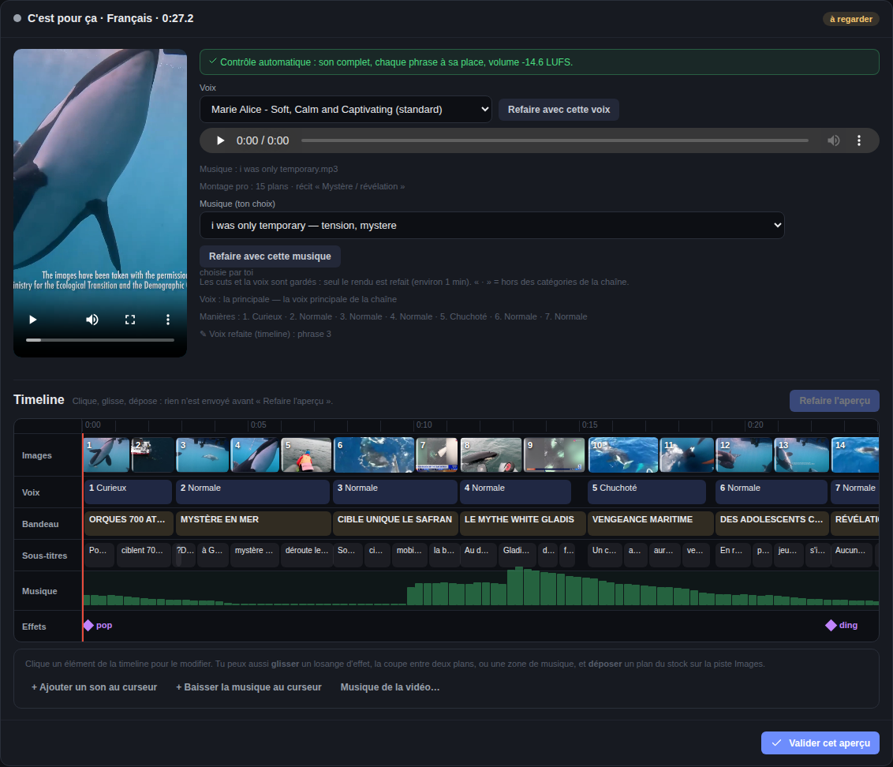
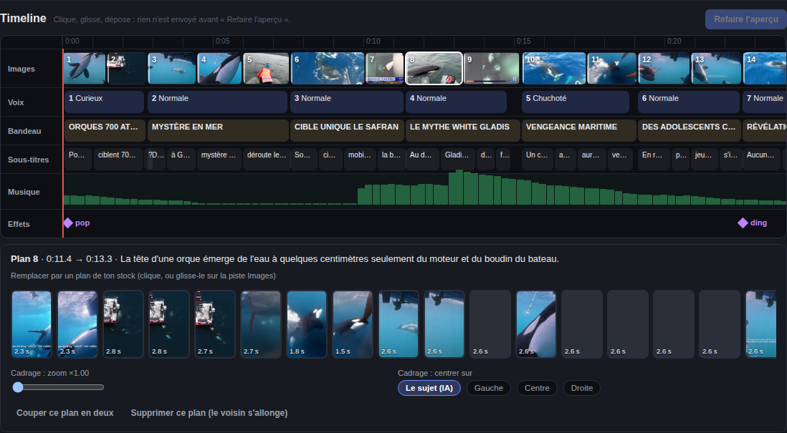
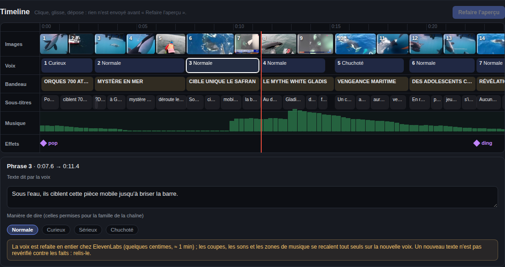
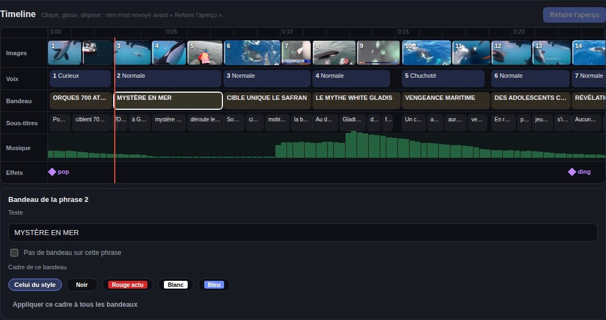
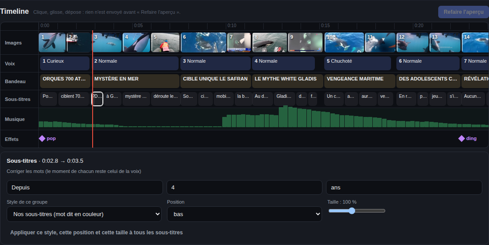
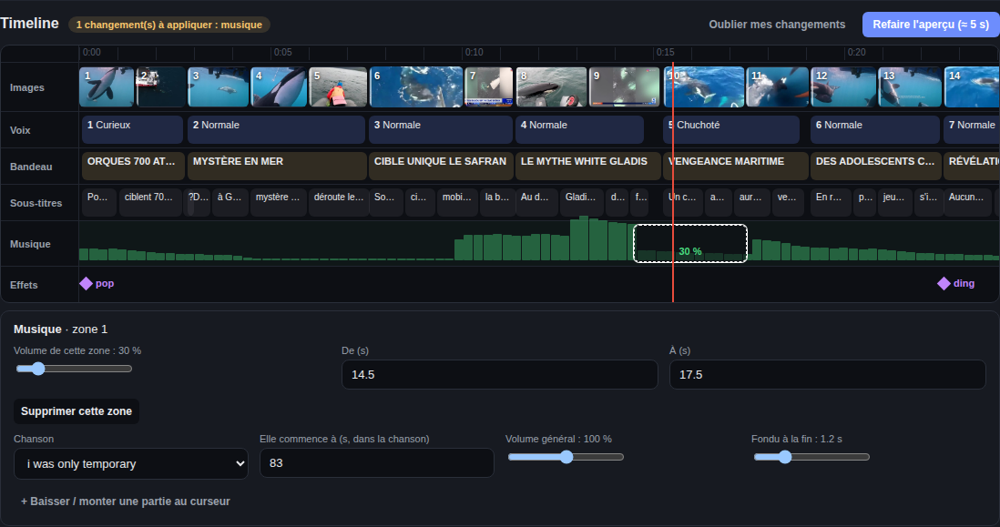
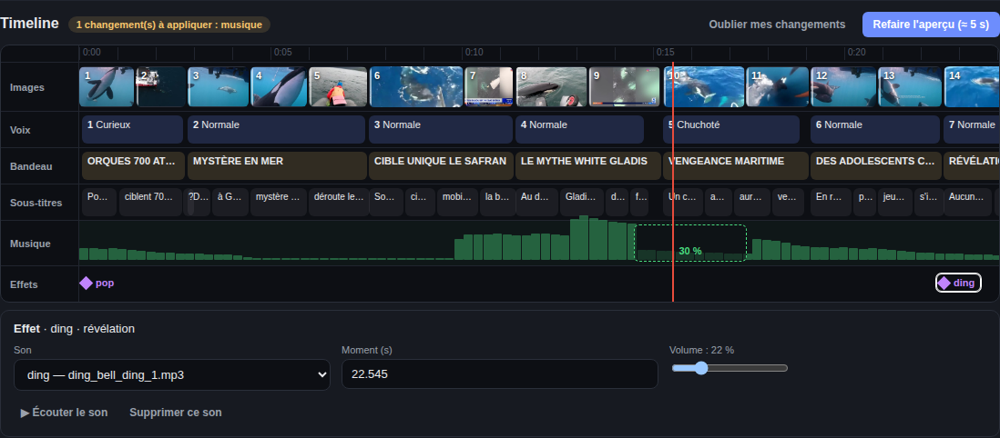
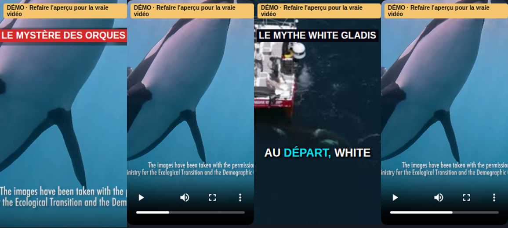

# Le montage modifiable (la timeline)

*Mis à jour le 10 novembre 2026.*

Dans **Adaptation → Idée d'abord**, à l'étape **Aperçu**, la vidéo est montée par l'IA. Sous l'aperçu, la **timeline** montre tout ce qui la compose, et te laisse **changer n'importe quel morceau avant de publier** : une image, son cadrage, un bandeau, un mot des sous-titres, le volume de la musique sur un passage, un effet sonore, la manière de dire une phrase.

> Pour l'instant, la timeline existe seulement pour le **montage pro** (Idée d'abord), sur ordinateur, et **avant** la publication.

**Pendant que l'IA travaille** (recherche des images, voix et rendu), la carte d'attente montre deux choses : en haut, la barre de **toute l'étape** ; en dessous, la **liste des sous-étapes**. Celles qui sont finies sont cochées ✓. Celle en cours a **sa propre barre, qui repart de 0** : avec son pourcentage quand on sait compter (« téléchargement des sources 3/8 »), sinon une barre qui bouge. La recherche des images prend la première moitié de la barre de l'étape, le stock (téléchargement, découpage, description, contrôle des images) la seconde.

## 1. Lire la timeline

| Piste | Ce qu'elle montre |
|---|---|
| **Images** | les plans, avec leur miniature et leur numéro (⌖ = un plan recadré) |
| **Voix** | les phrases dites, et la manière de chacune (Curieux, Chuchoté…) |
| **Bandeau** | le texte affiché en haut, phrase par phrase |
| **Sous-titres** | les mots, 3 par 3 |
| **Musique** | la forme de la chanson (plus c'est haut, plus c'est fort) et tes zones de volume |
| **Effets** | les sons (pop, whoosh, ding…), en losanges |

- Le **trait rouge** suit la vidéo pendant la lecture.
- **Clique un élément** : la vidéo va à ce moment, et le panneau en dessous montre ce que tu peux changer.
- **Clique la règle du temps** (en haut) pour aller à une seconde précise.

## 2. Changer un morceau ou toute la vidéo ?

**Ce que tu changes dans le panneau ne touche que le morceau cliqué.** Pour le cadre des bandeaux et le look des sous-titres, un bouton **« Appliquer à tous »** le met sur toute la vidéo.

| Ce qui change **seulement ce morceau** | Ce qui change **toute la vidéo** |
|---|---|
| un plan (le remplacer, zoom, centrer, couper, supprimer, déplacer sa coupe) | le bouton **Appliquer ce cadre à tous les bandeaux** |
| le texte, le **cadre** d'un bandeau, « pas de bandeau » | le bouton **Appliquer… à tous les sous-titres** |
| les mots, le **style**, la **position**, la **taille** d'un groupe de sous-titres | la chanson, son départ, son volume général, le fondu de fin |
| chaque zone de volume de la musique | — |
| chaque effet sonore | — |
| le texte ou la manière d'une phrase | — |

## 3. Comment l'app choisit les images (Images v2)

Un monteur humain ne cherche pas la scène exacte : il prend une image qui **fait passer l'idée** de la phrase, et qui ne la contredit jamais. L'app fait pareil :

| Étape | Ce qu'elle fait |
|---|---|
| **Le réalisateur IA** | avant de chercher, il décide **comment montrer chaque phrase** : vraies images (actualité), image d'idée, **comparaison** (« en forme de tente » → le stade **et** une tente), **projet** (rendu 3D, maquette), chiffre, carte ou schéma. Il suit un **guide de monteur** (depuis le 10 novembre) : une phrase simple = **1 image** ; une phrase qui cite plusieurs choses (« الرجاء والوداد والجيش », une comparaison) = **une image par chose, jusqu'à 4, dans l'ordre de la voix**, chacune avec le **mot** où elle commence ; il garde les détails précis (« les 32 escaliers ») et, pour une action rare à filmer, montre son résultat visible (des portes déjà marquées de numéros rouges). Les images sont cherchées en anglais **et dans la langue du pays** (en arabe pour le Maroc). Un **club, une entreprise ou une institution** nommé est aussi cherché **dans sa chaîne YouTube officielle** : l'app vérifie que la chaîne existe et porte bien son nom, sinon elle cherche la bonne (même nom, le plus d'abonnés) ; pas trouvée = recherche normale. Ces vidéos portent l'étiquette **« chaîne officielle »** et sont **réservées à leur phrase** : le monteur IA ne peut pas mettre le Wydad sur la phrase du budget, et le contrôle des lieux ne les écarte pas (le Camp Nou est à Barcelone, mais le réalisateur l'a demandé). Sur une liste de noms (« الرجاء والوداد »), une coupe peut être rapide (une demi-seconde) pour que chaque club ait son image. Ses choix sont visibles à l'écran du **stock** (« Le réalisateur IA » : le mot de départ entre « », la chaîne officielle en vert), avec ce que sont devenus ses graphiques (voir **Les graphiques animés** plus bas) |
| **L'idée de chaque phrase** | une courte description, en anglais, de ce que montrerait n'importe quelle vidéo qui fait passer l'idée (« new apartment buildings, a hand giving keys ») |
| **Recherche par le sens** | un modèle sur ton PC compare chaque plan du stock (3 images de lui) à **chaque phrase**, pas au sujet en général |
| **Repêchage** | un plan écarté comme « hors sujet » mais qui colle bien à une phrase revient dans le stock (badge vert *repêché*) |
| **Contrôle du lieu** (actualité) | une vidéo sur **un autre pays ou une autre ville** (NEOM pour Benslimane, Mayotte pour Casablanca) est écartée — l'autre quartier de la même ville reste |
| **Recherche de secours** | pour une phrase que rien ne fait passer, une vidéo est cherchée sur **Pixabay** et choisie par le sens (badge vert *secours*) ; pas de clip généré par IA en actualité |
| **Variété** | au plus **2 plans de la même vidéo** dans un montage |
| **Relecture** | le montage fini est relu (comme un monteur qui se relit) : chaque plan qui **contredit** sa phrase ou **ne colle pas** est entouré d'**orange** dans la piste Images |

À l'écran du **stock**, une ligne « Images v2 » résume ce qui a été fait. Ces étapes coûtent environ 5 centimes de Gemini par vidéo (la recherche par le sens est gratuite).

### Les graphiques animés

Quand le réalisateur choisit un **chiffre**, une **carte** ou un **schéma**, l'app le **dessine** elle-même (avec HyperFrames, sur ton PC, pendant le téléchargement des vidéos) :

| Graphique | Ce que tu vois | Ce qui est vérifié |
|---|---|---|
| **Chiffre** | un compteur qui monte jusqu'au chiffre, puis ses mots (« 115 000 مقعد ») | le chiffre doit être dans les **faits vérifiés**, sinon il n'est pas fait |
| **Carte** | une vue large (le pays, 1-2 grandes villes), un zoom jusqu'au lieu, un point rouge et son nom ; parfois un chiffre des faits | le lieu est trouvé sur **OpenStreetMap**, jamais placé par l'IA ; les **côtes seulement, aucune frontière** |
| **Schéma** | un dessin animé qui explique un mécanisme (« la chaleur piégée sous le voile ») | écrit par Gemini Flash (2-3 centimes), contrôlé avant le rendu |

Les règles :
- **au plus 2 graphiques en plein écran** par vidéo, **jamais deux phrases de suite** ;
- **l'accroche garde sa vraie image** : un chiffre y est posé **par-dessus** (🔢 sur le plan 1 de la timeline) ; une carte ou un schéma n'y est pas fait ;
- toutes les versions d'un projet doivent être dans la même langue (les mots du graphique sont dans cette langue).

Au **stock**, les graphiques sont dans la carte « Graphiques animés » : clique un graphique pour le retirer (sa phrase reprend de vraies images). Dans la **timeline**, un graphique est un plan comme un autre, marqué ✎ (pas de cadrage : il est dessiné pour l'écran) ; sur le plan 1, **Chiffre animé par-dessus l'accroche : Affiché / Enlevé**. Un graphique qui n'a pas pu être fait est dit à l'écran du stock, avec la raison : la phrase garde alors ses vraies images.

## 4. Les images

- **Plan entouré d'orange (⚠)** : la relecture dit pourquoi il ne colle pas et quoi montrer à la place ; quand le stock a mieux, **Mettre le plan proposé** le remplace en un clic.
- **Remplacer** : clique une miniature de ton stock, ou **glisse-la** sur un plan de la piste Images. Les plans sont **rangés du plus adapté à la phrase au moins adapté** ; ✓ = il fait passer l'idée de cette phrase ; *Pixabay* = un plan de secours.
- **Cadrage** : *zoom* pour serrer l'image (jusqu'à ×1,6), *centrer sur* le sujet (choix de l'IA), la gauche, le centre ou la droite.
- **Couper ce plan en deux** : la 2ᵉ moitié prend un autre plan de ton stock (change-le ensuite si tu veux).
- **Supprimer** : le plan d'avant s'allonge pour boucher le trou.
- **Déplacer une coupe** : glisse la **barre blanche** au début d'un plan. Elle se cale sur le mot le plus proche. Un plan dure au moins 1 seconde.

## 5. La voix

Tu peux changer le **texte** d'une phrase et sa **manière de dire** (seulement celles permises pour la famille de récit de la chaîne : pas de chuchoté en actualité, par exemple).

- La voix est **refaite en entier** chez ElevenLabs : quelques centimes, environ 1 minute.
- Les coupes, les effets et les zones de musique **se recalent tout seuls** sur la nouvelle voix (chacun garde sa place dans sa phrase).
- Un nouveau texte **n'est pas revérifié contre les faits** : relis-le.
- **Annuler le dernier rendu** remet l'ancienne voix **sans repayer** ElevenLabs.

## 6. Les bandeaux

Change le texte (60 caractères au plus), coche **Pas de bandeau sur cette phrase**, ou choisis le **cadre de ce bandeau** : celui du style de la chaîne, noir, rouge actu, blanc ou bleu (par exemple un bandeau rouge seulement sur la révélation). **Appliquer ce cadre à tous les bandeaux** le met partout.

## 7. Les sous-titres

- **Corriger les mots** d'un groupe : chaque mot garde le moment où la voix le dit.
- **Style de ce groupe** : *Nos sous-titres* (le mot dit en couleur) ou un des styles de **Réglages → Bibliothèques → Sous-titres** (Karaoké, Hormozi…).
- **Position** (bas, milieu, haut) et **taille** (60 à 160 %) de ce groupe. Les styles de la bibliothèque ont leur propre « bas », un peu plus près du bord.
- **Appliquer… à tous les sous-titres** met ce look sur toute la vidéo ; **Comme le reste de la vidéo** annule le look propre de ce groupe.

## 8. La musique

- Clique la piste Musique : **chanson**, **départ** dans la chanson (en secondes), **volume général**, **fondu à la fin**.
- **+ Baisser / monter une partie au curseur** : crée une zone de 3 secondes au trait rouge. Règle son volume (0 à 200 %) et ses bornes, ou **glisse-la** sur la piste. Pratique pour laisser entendre une phrase chuchotée.

## 9. Les effets sonores

- **Glisse un losange** pour déplacer le son.
- Au clic : changer le **son** (ceux allumés dans Réglages → Bibliothèques → Effets sonores), son **moment**, son **volume**, l'**écouter**, le **supprimer**.
- **+ Ajouter un son au curseur** : sans rien sélectionner, le bouton est dans le panneau.

## 10. La démo instantanée

Dès que tu changes quelque chose, l'aperçu montre une **DÉMO** (étiquette jaune) **par-dessus la vidéo**, sans attendre : lance la lecture ou clique la timeline pour la voir.

| Changement | Dans la démo |
|---|---|
| texte, cadre, bandeau enlevé | ✅ dessiné tel quel |
| mots, position, taille des sous-titres | ✅ très proche (l'ancien texte est flouté) |
| zoom et centrage d'un plan | ✅ très proche |
| plan remplacé | ⚠️ son **image fixe** |
| effet ajouté ou déplacé | ✅ joué à son moment (l'ancien reste audible) |
| zone de volume de la musique, style de la bibliothèque, voix | ❌ seulement après **Refaire l'aperçu** |

La démo est approximative : la vraie vidéo, c'est **Refaire l'aperçu**.

## 11. Appliquer, comparer, annuler

En haut de la timeline :

| Bouton | Ce qu'il fait |
|---|---|
| *compteur* « 3 changement(s) à appliquer » | rien n'est envoyé tant que tu n'as pas cliqué Refaire |
| **Refaire l'aperçu** | la vidéo est refaite avec tous tes changements, le lecteur saute au premier changement. ≈ 5 s si tu n'as touché qu'au son, ≈ 30 s sinon, ≈ 1 min avec la voix |
| **Voir l'avant / Voir l'après** | passe de l'ancienne à la nouvelle vidéo, au même moment (cadre jaune = l'avant) |
| **Annuler le dernier rendu** | revient au montage d'avant (et à sa voix) |
| **Oublier mes changements** | efface ce que tu n'as pas encore appliqué |

Après chaque rendu, le **contrôle automatique** du son repasse (chaque phrase à sa place, volume). Le bouton **Valider cet aperçu** ne s'allume que s'il est vert.

## 12. À savoir

- **« Revenir au stock »** refait un montage neuf par l'IA : tes changements dans la timeline seraient perdus. L'app te le demande avant.
- Un seul rendu à la fois : pendant un rendu, la timeline attend.
- La **recette** de la vidéo (Dashboard) note que le montage a été modifié par toi, combien de fois, les cadrages, les zones de musique et le cadre des bandeaux.
- Tout ça ne coûte **aucun crédit Gemini**. Seul un changement de voix coûte un peu chez ElevenLabs.
