# Tutoriel — Les Réglages

> À jour au 8 novembre 2026. Ce guide est mis à jour à chaque changement des Réglages.

Les Réglages sont rangés en **3 espaces**, en haut de l'écran Réglages :

| Espace | Ce qu'on y fait | Quand |
|---|---|---|
| **Chaînes** | Tout le réglage d'**une** chaîne, sur une seule page | Souvent |
| **Bibliothèques** | Ce qui est **partagé** par toutes les chaînes : voix, musiques, effets sonores, plans de drone, styles de sous-titres | Quand tu ajoutes une voix, une musique… |
| **App** | Ce qui concerne **toute l'app** : modèles d'IA, sauvegardes, stockage | Rarement |

Un réglage est **enregistré tout de suite** quand tu le changes, sauf dans la section Publication, qui a son bouton « Enregistrer ».

---

## 1. Chaînes

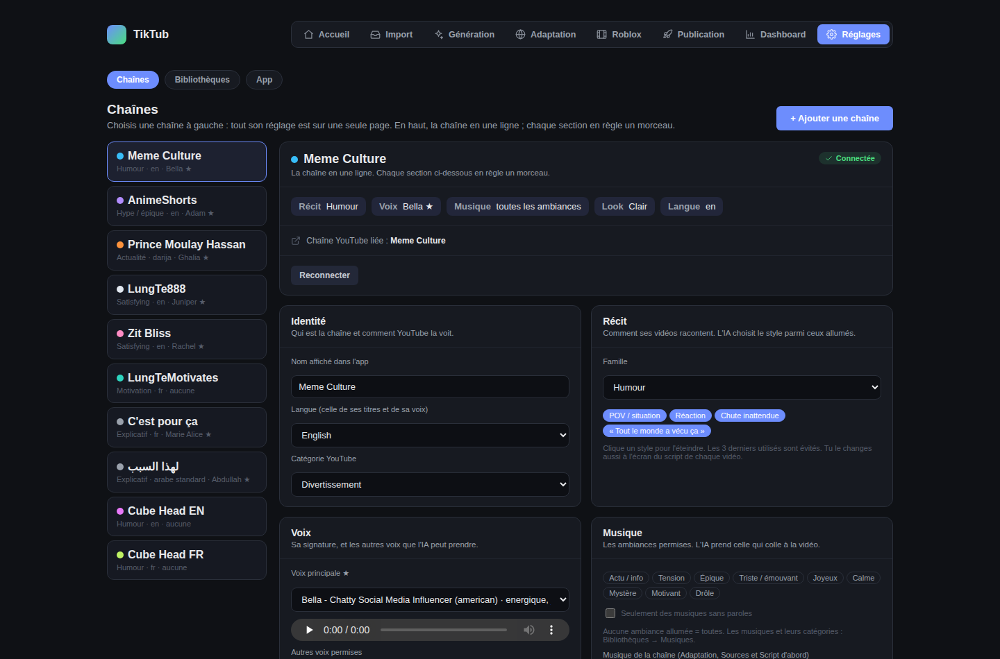

- **À gauche** : tes chaînes. Sous chaque nom, un mini-résumé (famille de récit · langue · voix principale ★).
- **Clique sur une chaîne** : sa page s'ouvre à droite.
- **« + Ajouter une chaîne »** (en haut à droite) : connecte une nouvelle chaîne YouTube. Sa page s'ouvre à la fin.

### 1.1 Le résumé : la chaîne en une ligne

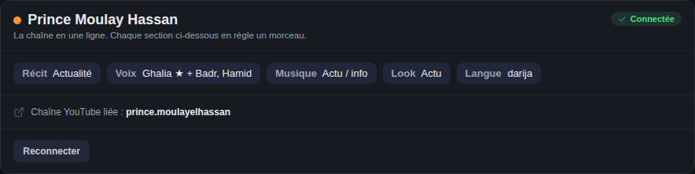

En haut de la page, tu vois d'un coup d'œil comment la chaîne est réglée :

- **Récit** : sa famille (Actualité, Explicatif, Humour…) ;
- **Voix** : sa voix principale ★ et les autres voix permises ;
- **Musique** : les ambiances permises ;
- **Look** : son style visuel ;
- **Langue** : avec « darija » ou « arabe standard » pour une chaîne arabe.

Dessous : **sa connexion YouTube** (la chaîne YouTube liée) et le bouton **Reconnecter** si la connexion a expiré.

Chaque section ci-dessous règle **un morceau** de cette ligne.

### 1.2 Identité

- **Nom affiché dans l'app** : le nom que tu vois partout dans TikTub.
- **Langue** : celle de ses titres **et** de sa voix. La changer enlève la voix principale (il faut en choisir une dans la nouvelle langue).
- **Arabe parlé** *(chaînes arabes seulement)* : *arabe standard (fusha)* ou *darija marocaine*. En darija, la voix et les sous-titres sont en darija ; le titre, la description et les tags restent en fusha, parce que c'est ce que les gens tapent dans la recherche.
- **Catégorie YouTube** : envoyée à YouTube avec chaque vidéo publiée. Au choix : Divertissement, Actualités et politique, Éducation, Science et technologie, Jeux vidéo, Humour, Sport, Animaux, Vie pratique et style, Voyages et événements, Auto et véhicules, Personnes et blogs, Films et animation, Musique.

### 1.3 Récit — comment ses vidéos racontent

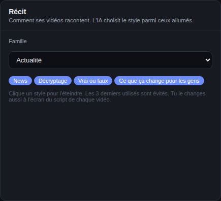

1. Choisis la **famille** de la chaîne :

   | Famille | Ses styles |
   |---|---|
   | Actualité | news · décryptage · vrai ou faux · ce que ça change pour les gens |
   | Explicatif | mystère / révélation · fait surprenant · origine · explication · top |
   | Humour | POV · réaction · chute inattendue · « tout le monde a vécu ça » |
   | Hype / épique | montée en puissance · top moments · « le moment où… » · face à face |
   | Motivation | lettre à toi · affirmations · histoire inspirante · sagesse · mythe ou réalité |
   | Satisfying | révélation lente · avant / après · processus étape par étape · ASMR calme |

2. Les **pastilles bleues** sont les styles allumés. **Clique une pastille pour l'éteindre** (elle devient grise) : l'IA ne la prendra plus pour cette chaîne.

**Ce qui se passe ensuite :** pour chaque vidéo, l'IA lit le sujet et choisit **le style qui le raconte le mieux** parmi ceux allumés, en évitant les 3 derniers utilisés par la chaîne. Exemple : une rumeur → « Vrai ou faux » ; « les 5 animaux les plus rapides » → « Top ».

**Tu peux changer le style d'une vidéo** à l'écran de son script : menu des styles, puis **« Réécrire dans ce style »** (environ 1 minute).

**Les faits sont vérifiés** *(Idée d'abord)* : après l'écriture et après chaque réécriture (la tienne ou celle de l'IA), chaque phrase est comparée aux faits trouvés sur le web. Une phrase qui invente ou contredit un fait est corrigée automatiquement une fois ; si elle reste fausse, elle apparaît **en rouge** à l'écran du script et tu ne peux pas valider avant de la corriger. En **Actualité**, le script donne aussi l'autre version quand les faits la contiennent (un syndicat, une réponse…), sans mots accusateurs, et l'accroche garde le chiffre clé.

Concerne : Idée d'abord, Script d'abord, Sources d'abord et Reprise.

### 1.4 Voix

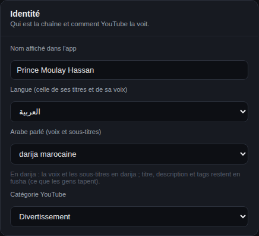

- **Voix principale ★** : la signature de la chaîne. Le menu montre ses tons et ta note (ex. « chaleureuse, douce · 8/10 »). Écoute l'extrait sous le menu.
- **Autres voix permises** : coche celles que l'IA peut prendre quand le sujet le demande. Pour une chaîne en **darija**, seules les voix marocaines sont proposées.
- **Choix de la voix** :
  - *L'IA choisit selon le sujet* : elle garde la ★, sauf si elle a une vraie raison (qu'elle écrit). Exemple : une histoire racontée par une femme ;
  - *Toujours la voix principale* : la ★ à chaque vidéo.

**Ce qui se passe ensuite** *(Idée d'abord)* : après l'écriture du script, l'IA choisit la voix **et la manière de dire chaque phrase**, parmi celles que permet la **famille de récit** de la chaîne, avec **au plus 2 phrases spéciales** par vidéo :

| Famille | Manières permises |
|---|---|
| Actualité | normale, sérieux, calme |
| Explicatif | normale, curieux, sérieux, chuchoté |
| Humour | normale, excité, curieux |
| Hype / épique | normale, excité, sérieux |
| Motivation | normale, calme, triste |
| Satisfying | normale, calme, chuchoté |
 Tu vois et changes les deux à l'écran du script (bloc **Casting**, et le menu **« Manière de le dire »** sous chaque phrase), ou à l'aperçu.

Pour ajouter une voix : **Bibliothèques → Voix**.

### 1.5 Musique

- **Les ambiances permises** : allume les ambiances qui conviennent à la chaîne (Actu, Tension, Calme, Épique, Triste…). **Aucune allumée = toutes.**
- **Seulement des musiques sans paroles** : coche-la pour qu'aucune voix ne chante sous la narration.
- **Musique de la chaîne** : le morceau fixe utilisé par Adaptation, Sources d'abord et Script d'abord, avec l'instant de départ (« Prendre l'instant du lecteur » prend l'endroit où tu as mis le lecteur en pause).
  Le menu est vide (« — aucune — ») quand la chaîne n'a **pas de morceau à elle** : c'est normal. En Idée d'abord, l'IA choisit dans **Bibliothèques → Musiques** ; pour un morceau fixe, ajoute-le dans **Avancé → Montage auto → Ajouter**.

**Ce qui se passe ensuite** *(Idée d'abord)* : pour chaque vidéo, l'IA prend la musique qui colle à l'ambiance, parmi tes musiques classées et permises. À l'aperçu, le menu **Musique** et **« Refaire avec cette musique »** la changent ; la voix et les coupes sont gardées, seul le rendu est refait (environ 1 minute).

Pour ajouter une musique ou corriger ses catégories : **Bibliothèques → Musiques**.

**Coût du montage pro** *(Idée d'abord, depuis le 12 novembre)* : le choix par défaut de la chaîne, que tu peux changer à la création de chaque projet.
- **Économique** (par défaut, ≈ 0,10-0,15 $ le montage) : un modèle **gratuit sur ton PC** trie les plans téléchargés ; Gemini ne décrit que les meilleurs de chaque phrase et de chaque vidéo (44 sur 220 pour le Grand Stade), et le monteur IA réfléchit moins. Testé sur 3 vidéos : jugé aussi bon.
- **Qualité max** (≈ 0,55 $) : Gemini décrit **tous** les plans, le monteur IA réfléchit autant qu'il veut.

### 1.6 Look

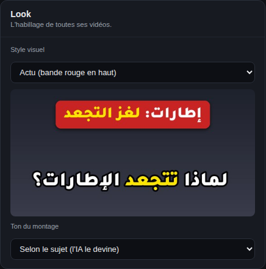

- **Style visuel** : les bandeaux et les sous-titres de toutes ses vidéos. L'image montre le rendu (ex. « Actu » = la bande rouge en haut).
- **Ton du montage** : *Selon le sujet* (l'IA le devine à chaque vidéo) ou *Toujours calme / explicatif / spectaculaire / drôle*. Un ton fixe garde la même musique, les mêmes effets et les mêmes sons : la signature de la chaîne.

### 1.7 Publication

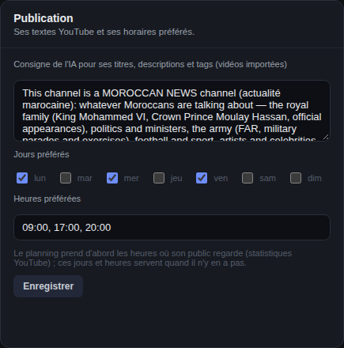

- **Consigne de l'IA** : ce que l'IA doit savoir de la chaîne pour écrire les titres, descriptions et tags des **vidéos importées**.
- **Jours préférés** et **heures préférées** (format `09:00, 17:00, 20:00`) : le planning prend d'abord les heures où le public de la chaîne regarde vraiment (statistiques YouTube). Ces jours et heures servent quand il n'y en a pas.
- Clique **Enregistrer** : cette section ne s'enregistre pas toute seule.

### 1.8 Avancé (replié)

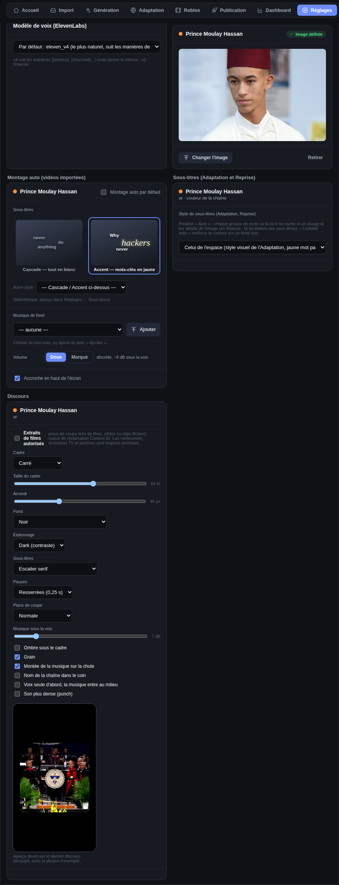

Clique **« Avancé »** en bas de la page pour l'ouvrir. Il contient les réglages qu'on touche rarement :

- **Modèle de voix (ElevenLabs)** : *eleven_v4* par défaut. v4 suit les manières de dire, mais ignore la vitesse ; v3 fait l'inverse.
- **Fond** : l'image qui remplit les bordures des vidéos importées.
- **Montage auto** : le style par défaut des vidéos importées (sous-titres, musique, accroche…).
- **Sous-titres** : le style de sous-titres de la chaîne pour l'Adaptation et la Reprise.
- **Discours** : le cadre, le fond, les sous-titres et la musique des vidéos « Discours », et si les plans de coupe peuvent être des extraits de films.

---

## 2. Bibliothèques

Les onglets en haut : **Voix · Musiques · Effets sonores · Fonds et drones · Sous-titres · Prononciation**.

### 2.1 Voix

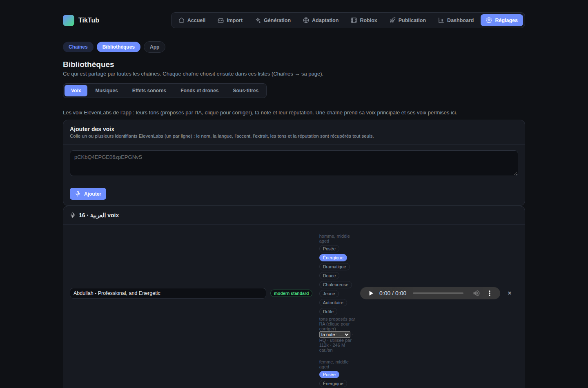

- **Ajouter des voix** : colle un ou plusieurs identifiants ElevenLabs (un par ligne), puis **Ajouter**. Le nom, la langue, l'accent, l'extrait, les **tons** et la **réputation** sont récupérés tout seuls.
- Pour chaque voix :
  - **les tons** : proposés par l'IA. Clique une pastille pour la corriger ; ton choix gagne toujours ;
  - **ta note** sur 10 (optionnelle) : l'IA en tient compte quand elle choisit ;
  - **la réputation** : Pro ou HQ, combien de gens l'utilisent, combien de caractères elle a lus en un an ;
  - le **nom** (modifiable), l'**extrait** à écouter, et **✕** pour la retirer.

### 2.2 Musiques

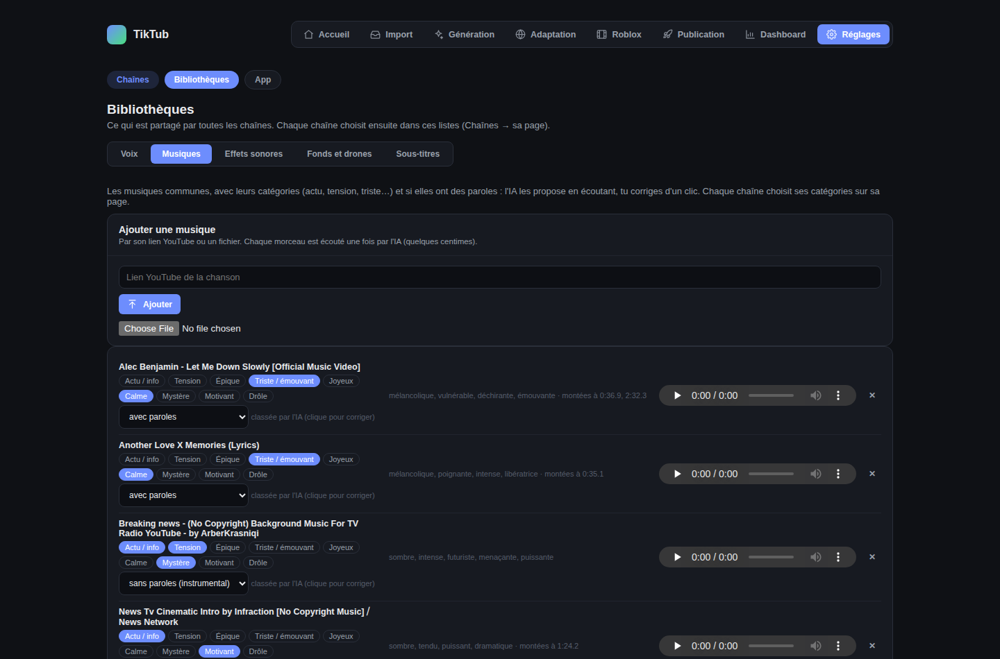

- **Ajouter une musique** : par son **lien YouTube** ou un **fichier audio**. L'IA l'écoute une fois (quelques centimes) : son humeur, ses montées, ses **catégories** et si elle a des **paroles**.
- Pour chaque musique :
  - **les catégories** : clique une pastille pour corriger ;
  - **paroles** : *sans paroles (instrumental)* ou *avec paroles*. Corrige si l'IA s'est trompée ;
  - « classée par l'IA » ou « classée par toi » te dit qui a décidé.

### 2.3 Effets sonores

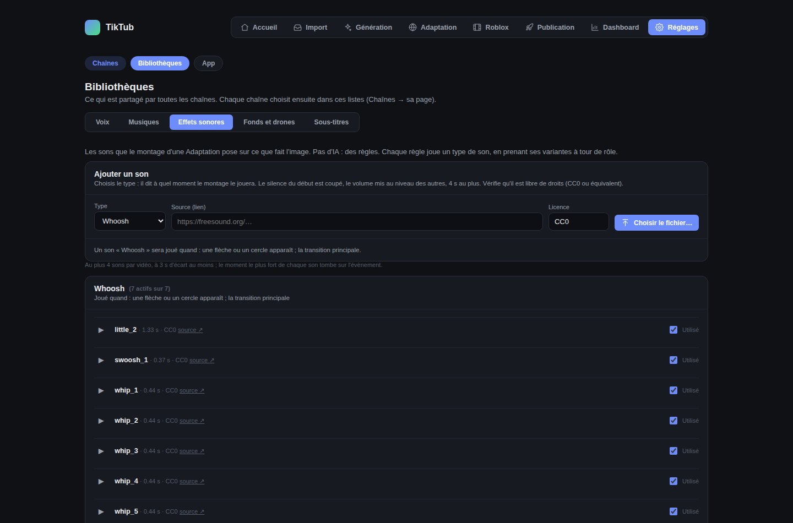

Les sons que le montage d'une Adaptation pose sur l'image (whoosh, impact…). Choisis le **type**, la **source** et la **licence**, puis le fichier. Vérifie qu'il est libre de droits.

Chaque type dit **quand il est joué**. Dans le **montage pro** (Idée d'abord), les sons tombent sur les vrais moments du récit, jamais sur une phrase chuchotée :

| Moment | Son |
|---|---|
| L'accroche | impact (ou pop si l'impact est éteint et que le bandeau a un chiffre) |
| Un bandeau avec un chiffre | pop |
| Le récit commence (2e phrase) | whoosh |
| La réponse | ding si le style a une révélation (mystère, fait surprenant…), sinon whoosh |

Le nombre de sons dépend de la **famille de récit** de la chaîne : Actualité 2 au plus (whoosh, pop), Explicatif et Humour 4, Hype 5, Motivation 1 (whoosh), Satisfying 1 (pop ou ding). Deux sons sont toujours à 3 secondes l'un de l'autre au moins. **Éteins un son ici et il n'est plus jamais joué.**

### 2.4 Fonds et drones

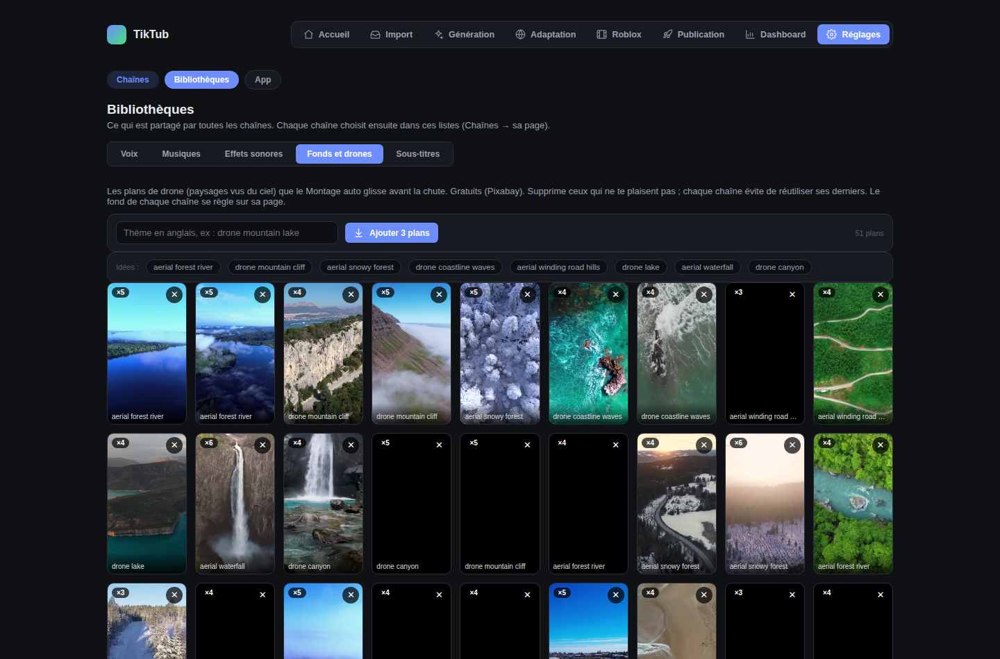

Les plans de drone que le Montage auto glisse avant la chute. Tape un thème **en anglais** (ex. *drone mountain lake*), puis **Ajouter 3 plans**. Supprime ceux qui ne te plaisent pas.

### 2.5 Sous-titres

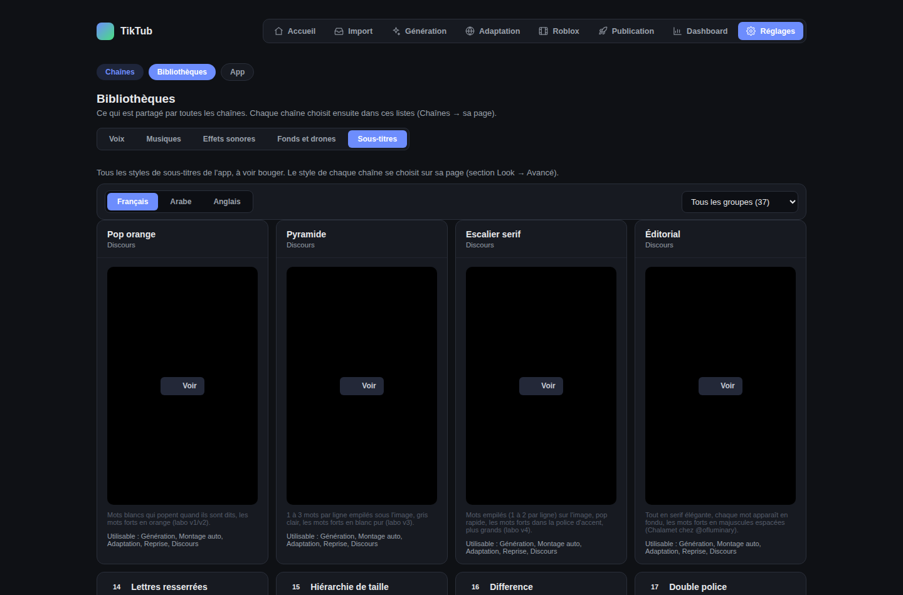

Les 37 styles de sous-titres de l'app, à voir bouger. Choisis la langue (Français / Arabe / Anglais) et un groupe. Le style d'une chaîne se choisit sur sa page (**Chaînes → la chaîne → Avancé → Sous-titres**).

---

### 2.6 Prononciation

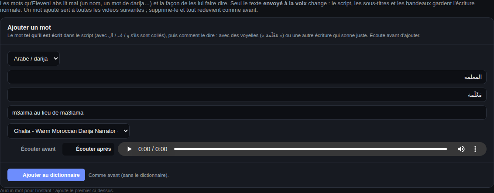

Les mots qu'ElevenLabs lit mal (un nom propre, un mot de darija : « المعلمة » dit *m3alma* au lieu de *ma3lama*, « جرادي » avec un G…) et la façon de les lui faire dire.

1. Choisis la **langue** et une **voix** (celle de ta chaîne, par exemple Ghalia).
2. Écris le **mot tel qu'il est écrit dans le script** (avec و / ف / ال s'ils sont collés au mot), puis **comment le dire** : avec des voyelles (« مَعْلَمة ») ou une autre écriture qui sonne juste (« پارطمات » pour un P).
3. **Écouter avant** fait entendre la lecture actuelle, **Écouter après** ta version. Change l'écriture jusqu'à ce que ça sonne juste.
4. **Ajouter au dictionnaire**.

Ce qui change, et ce qui ne change pas :

| | |
|---|---|
| ✅ change | seulement **le texte envoyé à la voix**, et seulement ce **mot entier** (jamais un morceau d'un autre mot) |
| ❌ ne change pas | le script, les **sous-titres** et les bandeaux gardent l'écriture normale ; les autres mots |
| ↺ | une vidéo déjà faite garde sa voix ; la **prochaine** voix (ou « Refaire l'aperçu » avec un changement de voix) prend le dictionnaire |
| 🗑 | **Supprimer** un mot : il est de nouveau lu comme avant |

**Les nombres en darija** *(automatique)* : quand une chaîne parle **darija**, ses nombres sont envoyés à la voix **en mots darija** — « 2 » → جوج, « 22 » → تنين وعشرين, « 110 » → مية وعشرة, « 2029 » → ألفين وتسعة وعشرين, « 3,5 » → تلاتة ونص (les autres décimales : « فاصلة »), « 30% » → تلاتين فالمية, « 11 000 » → حداش ألف, « 2 مليون » → جوج ملايين (« ملايين » de 2 à 10). Les **unités abrégées** sont dites en entier : كلم → كيلومتر, م → متر (seulement après un nombre, jamais après une année : « 2029 م » est une date), م³ → متر مكعب, كلغ → كيلو, كلم/س → كيلومتر فالساعة. Les **sous-titres, le script et les bandeaux gardent les chiffres**. Une heure (« 14:30 »), un score (« 2-1 ») ou « 07 » restent tels quels. En **arabe classique**, les chiffres restent des chiffres mais les unités abrégées sont aussi dites en entier (« 3 كلم » → 3 كيلومتر, كلغ → كيلوغرام, « 1400 م » → 1400 متر). Le français et l'anglais ne changent pas. *(Écoute à l'aveugle du 13/11 : nombres en mots 4/5 puis 9/10, chiffres 3/5.)*

**Si le dictionnaire ne se lit pas** (le disque est occupé un instant), l'app réessaie, puis **refuse l'ajout ou la suppression** avec un message — elle ne réécrit jamais le dictionnaire à moitié. Réessaie quelques secondes plus tard.

Les voyelles (tashkeel) restent limitées aux mots de la liste : le reste du texte part sans, comme d'habitude.

### 2.7 Chaînes à éviter

Les chaînes YouTube dont l'app n'utilise **jamais** les vidéos — par exemple une chaîne qui montre des **images générées par IA** comme si c'était le vrai chantier (« عين على مشاريع الغد », dans la liste dès le départ). Écris son **nom tel que YouTube l'affiche** sous la vidéo (majuscules, accents et espaces ne comptent pas), ajoute une note si tu veux, puis **Ajouter à la liste**. Ses vidéos sont retirées de chaque recherche **avant** que l'IA en regarde une. **Retirer** la remet dans les recherches suivantes.

## 3. App

Les onglets en haut : **Modèles d'IA · Sauvegardes · Stockage**.

### 3.1 Modèles d'IA

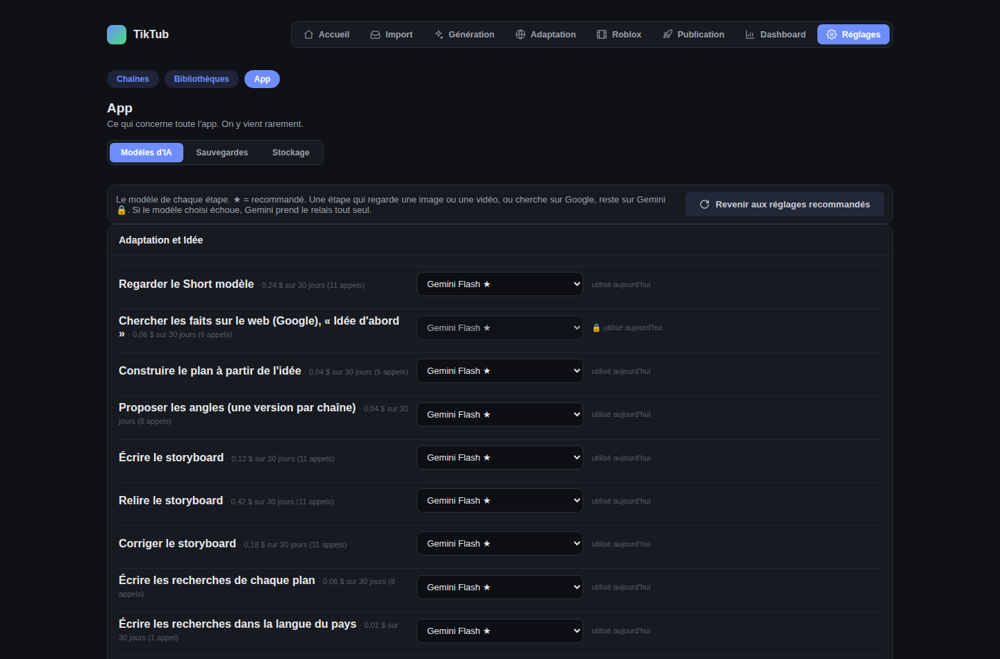

Le modèle qui fait chaque étape (Gemini, DeepSeek, OpenAI), avec ce qu'il a coûté sur 30 jours. ★ = recommandé. 🔒 = une étape qui regarde une image ou une vidéo, ou qui cherche sur Google : elle reste sur Gemini. **« Revenir aux réglages recommandés »** remet tout comme conseillé.

### 3.2 Sauvegardes

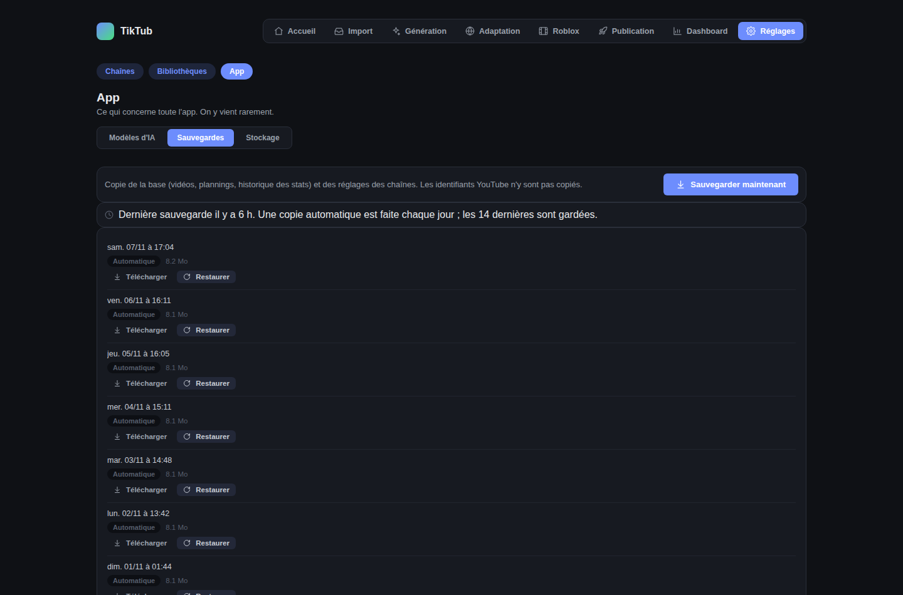

**« Sauvegarder maintenant »** copie la base (vidéos, plannings, historique des stats) et les réglages des chaînes. Les identifiants YouTube ne sont pas copiés.

### 3.3 Stockage

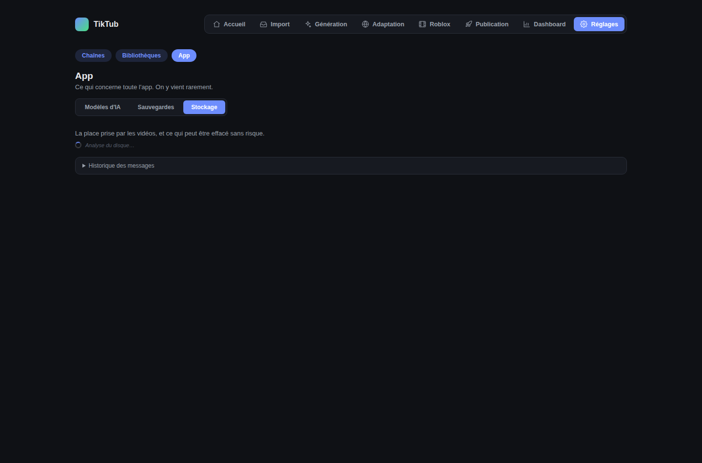

La place prise par les vidéos, et ce qui peut être effacé sans risque.

---

## Sur téléphone

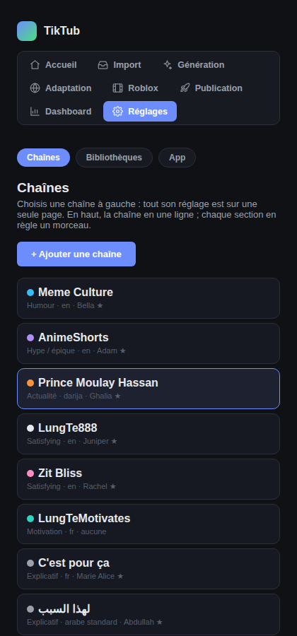

La liste des chaînes passe au-dessus, et les sections s'affichent l'une sous l'autre.

---

## Questions fréquentes

**Où est passé l'ancien onglet « Voix et langues » ?** Coupé en deux : la bibliothèque des voix est dans **Bibliothèques → Voix** ; la langue, la voix et la musique d'une chaîne sont sur **sa page** (Chaînes).

**Où est la connexion YouTube d'une chaîne ?** En haut de sa page, sous le résumé.

**Et le fond, le Montage auto, les sous-titres, le Discours d'une chaîne ?** Sur sa page, dans **Avancé** (en bas).

**Un réglage n'a pas l'air enregistré ?** Tout s'enregistre au changement, sauf la section **Publication** (bouton « Enregistrer »). Un message « Enregistré » s'affiche en bas.
